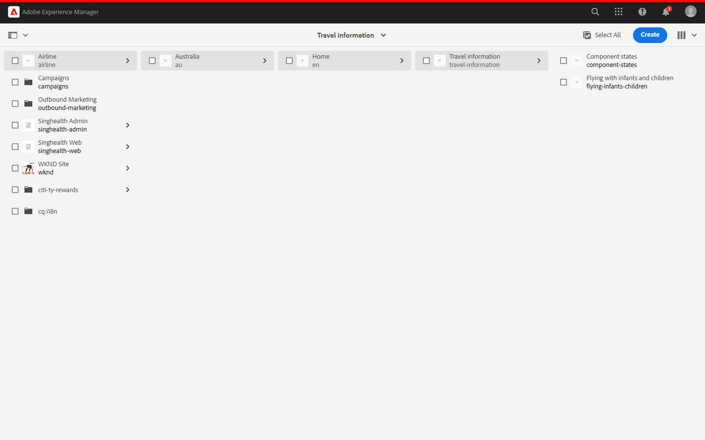
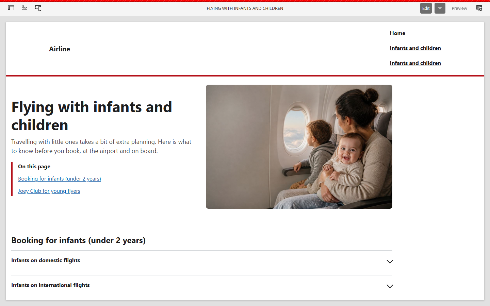
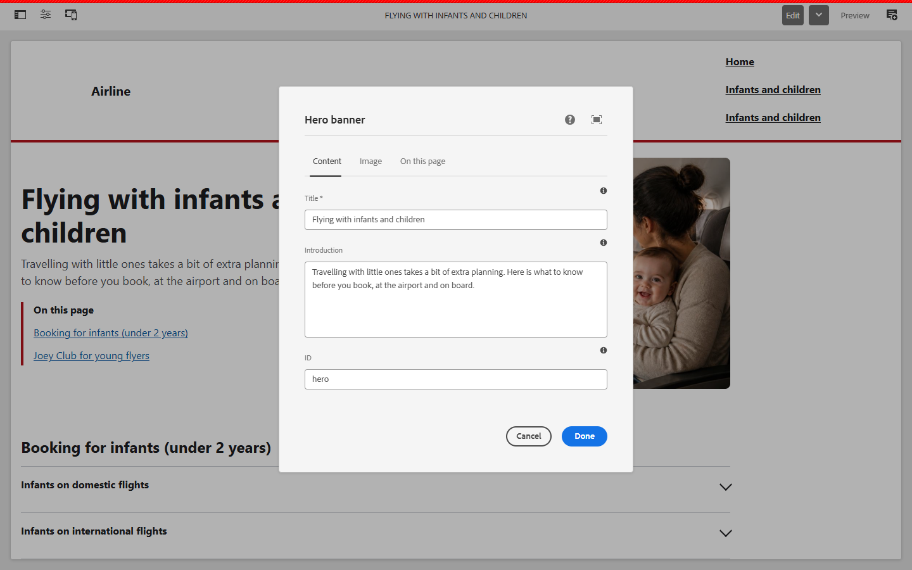
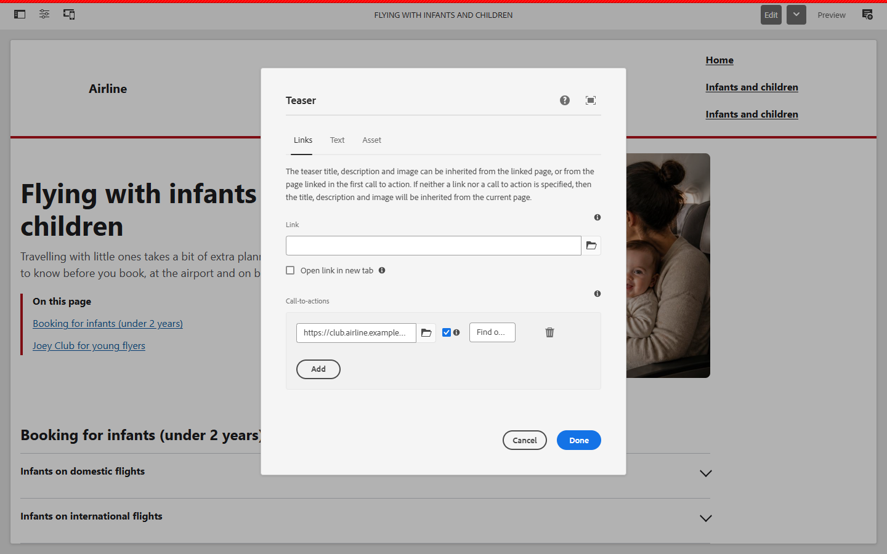
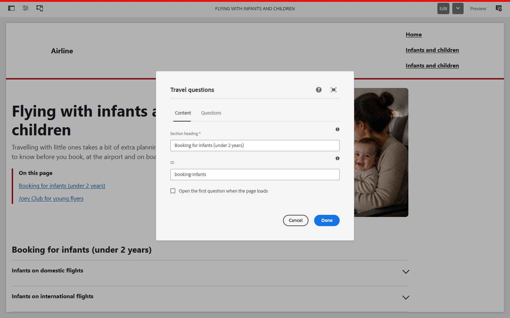
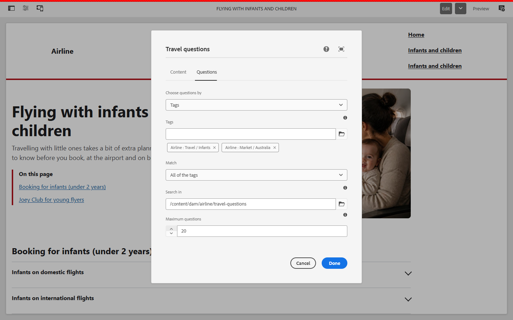
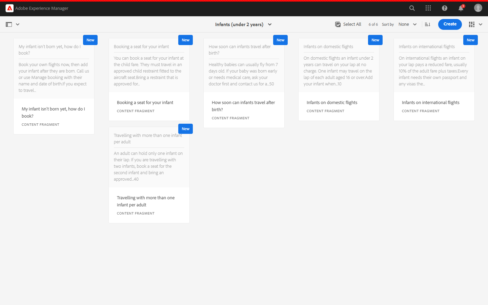
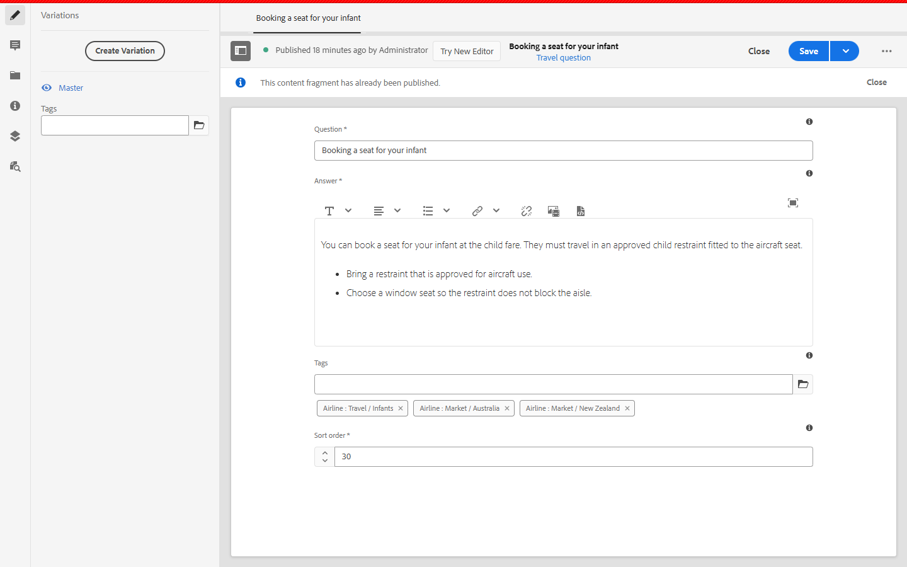
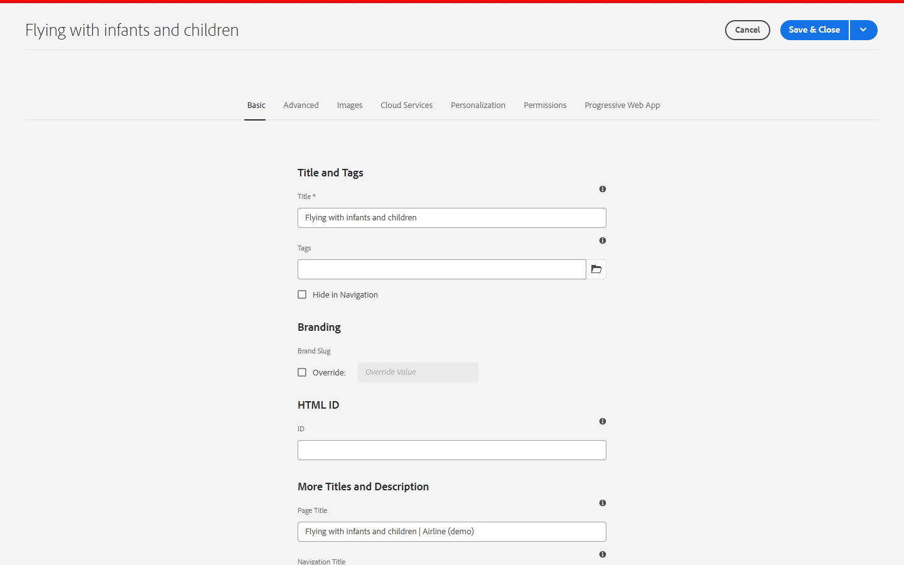
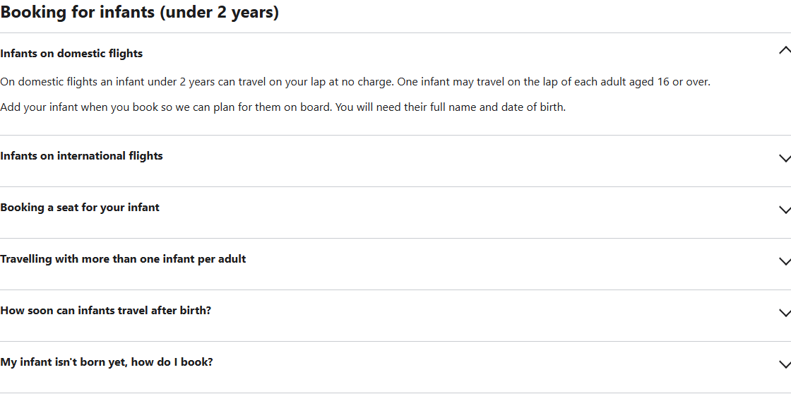

# Authoring guide: "Flying with infants and children"

This guide is for content authors. It covers building the page, changing the travel questions, and publishing. The screenshots come from the local AEM SDK, captured with `ui.tests/test-module/scripts/authoring-screenshots.ts`.

## 1. Find the page

Open **Sites**, then **Airline › Australia › English › Travel information**. The page is **Flying with infants and children**. Select it, then choose **Edit**.

The page is built from the **Travel information** template. The header and footer are locked Experience Fragments, so you can't edit them on this page. The hero sits in the template structure, so you can always edit it but can't delete it. The content area accepts only the components this page needs: Travel questions and Teaser.

## 2. Hero banner

Select the hero, then choose the spanner (Configure).

| Tab | Field | What to enter |
|---|---|---|
| Content | Title (required) | The page heading. It is the page's only h1 |
| Content | Introduction | Plain text, up to 400 characters |
| Content | ID | Leave blank unless another page links to the hero |
| Image | Image | Drag an image from Assets. The hero shows an image sized for the visitor's screen |
| Image | Decorative | Tick only if the image adds no information. Screen readers then skip it |
| Image | Alternative text | Describe what the image shows. Leave blank to use the asset's **Description** from Assets. If neither is set, the image is not shown, so the page never has an image without alt text |
| On this page | Heading, Links | Each link has a **Label** and a **Section ID**. The Section ID is the **ID** of a component further down the page, for example `booking-infants` |

If the title is empty, the editor shows a placeholder. Nothing appears on the published page.

## 3. Joey Club teaser

Select the teaser, then choose Configure. It is the standard Core Components teaser with this project's style.

- **Links** tab: add a call to action with its link and text. Tick **Open in new tab** for external sites such as Joey Club. The page then adds `rel="noopener noreferrer"` itself.
- **Text** tab: title and description. The template sets the heading level, so you can't change it here.
- **Asset** tab: the image. Its alt text comes from the asset, as for the hero.

## 4. Travel questions accordion

The accordion lists **travel question** Content Fragments. The same fragments feed the page's FAQ structured data for search engines, and the airline app through GraphQL. You change an answer in one place, the fragment, and every channel updates.

### Configure the component

- **Section heading**: for example "Booking for infants (under 2 years)". The template sets the heading level.
- **ID**: the section ID used by the hero's **On this page** links, for example `booking-infants`.

**Choose questions by** offers two modes:

| Mode | Fields | Use it when |
|---|---|---|
| **Folder** | Folder | One folder holds exactly the questions for this section. Subfolders are included |
| **Tags** | Tags, Match, Search in | Questions are shared across sections or markets. **All of the tags** narrows (for example `travel/infants` and `market/au`); **Any of the tags** widens. Tags match exactly: a parent tag does not include its children |

**Maximum questions** is 1 to 20. If more questions match, only the first ones in sort order are shown. To keep the page fast, the search looks at no more than 100 assets. If it stops early, the editor shows *Some travel questions may be missing*. Visitors don't see that warning.

An accordion with nothing configured, or with no matching questions, shows a placeholder in the editor and nothing on the published page. See the **Component states** page for examples.

### Add or change a question

1. Open **Assets › Files › airline › travel-questions › infants**. Use the folder that matches the audience.

   

2. To change a question, open its fragment. To add one, choose **Create › Content Fragment** and pick the **Travel question** model.

   

   | Field | Notes |
   |---|---|
   | Question (required) | The button text, up to 255 characters. Write it as a question or a short topic |
   | Answer (required) | Paragraphs, bulleted lists, bold, italics and links. Links must start with `https:`, `mailto:`, `tel:`, `/` or `#`; other links are removed. Headings, tables and embedded media are removed too, so the answer stays accessible and valid in FAQ results |
   | Tags | Pick from **Airline › Travel** (audience) and **Airline › Market** (country). You can't create new tags here; ask the taxonomy owner |
   | Sort order (required) | Lower numbers come first. Use steps of 10 so you can slot new questions in between. Questions with the same number sort by question text |

3. Choose **Save**, then publish the fragment (see section 6). You don't need to republish the page. The page and the app pick up the change within about five minutes, because of the cache lifetimes.

Legal review applies to answer wording. Get it approved before you publish.

## 5. Page properties

Choose **Page Information › Open Properties**.

- **Title**: used in the browser tab and search results.
- **Description**: the search-result snippet, about 150 characters.
- **Advanced › Robots**: leave empty for normal pages. The demo **Component states** page is set to `noindex, nofollow`.

The canonical link is generated from the page's URL. You can't edit it.

## 6. Publish

1. Publish the fragments you changed: select them in Assets, then choose **Quick Publish**.
2. Publish the page from Sites: **Quick Publish**, or **Manage Publication** to schedule it.
3. Publish new tags and images first. **Manage Publication** lists the page's references and can publish them together.

The published accordion opens one item at a time. Visitors can also use the keyboard or the browser's find-in-page search to reach a collapsed answer.

## 7. Troubleshooting

| You see | Cause | Fix |
|---|---|---|
| The accordion placeholder in the editor | No folder or tags set, or nothing matches | Check the mode and the tags. With **All of the tags**, every fragment must carry every tag |
| A question is missing | Wrong folder, missing tag, or not published | Check the fragment's tags and publication status |
| "Some travel questions may be missing" | The folder or tag search covers more than 100 assets | Choose a smaller folder or more specific tags |
| A link disappeared from an answer | The link wasn't on the allowed list | Use a full `https:` address or a site path |
| The hero image is missing | No alt text, no asset description, and not decorative | Add alt text, add a description in Assets, or tick **Decorative** |
