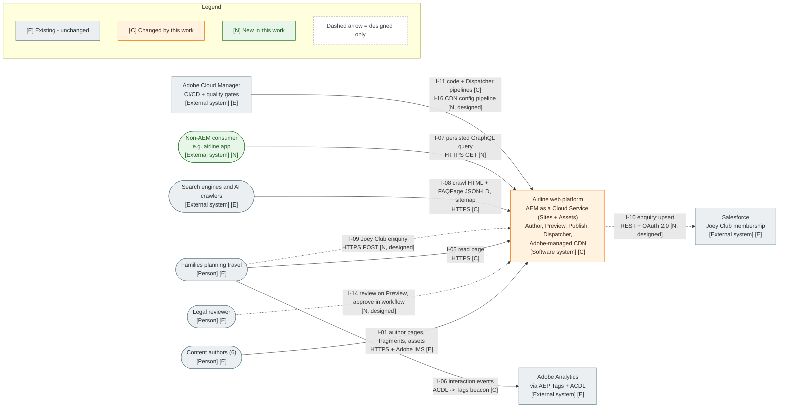
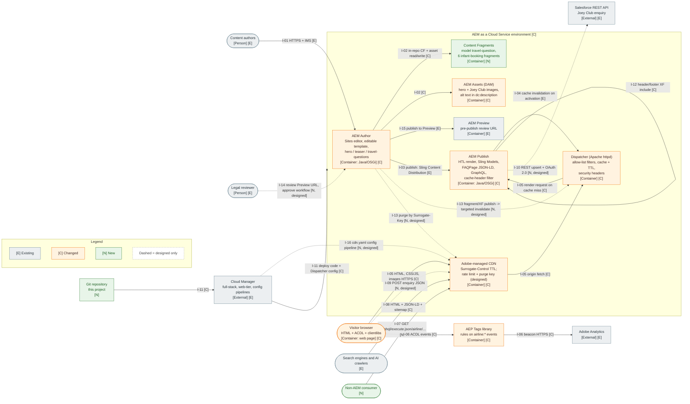
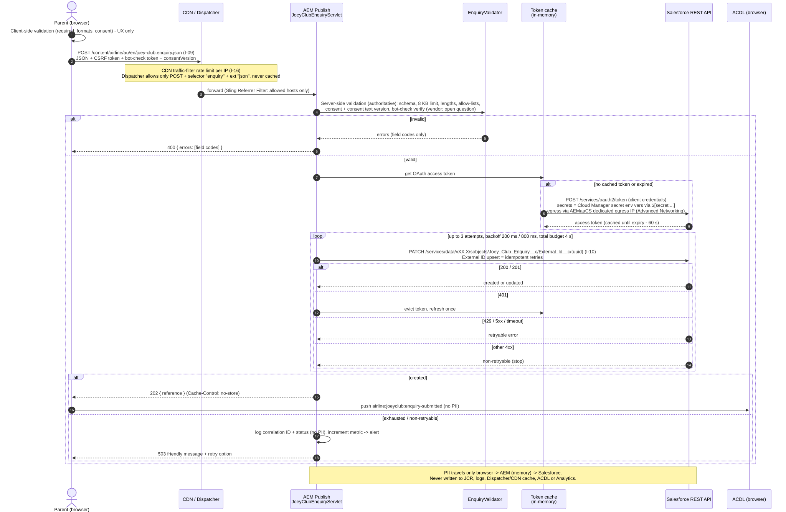

# Solution design — "Flying with infants and children"

**Audience:** Anchora architect and the airline's technical lead. **Status:** v1.1. v1.0 was reviewed by an independent architect review (`docs/03-architect-review.md`, 30 findings); every finding is resolved in that document's *Review resolution* table.
**Diagram as code (SD-03):** Mermaid sources are in `docs/diagrams/*.mmd`, rendered to `docs/diagrams/rendered/*.svg` by `scripts/render-diagrams.ps1`. The Mermaid blocks below are copied from the sources by `scripts/sync-diagrams.ps1`. `scripts/check-traceability.ps1` checks that every `I-xx` agrees across the diagrams, this document and the ADRs.
Integrations are numbered `I-01`..`I-16`, and those numbers are used in the diagrams, the integration register (§5) and the decision records (§9). Engineering detail is in `docs/02-design.md`.

---

## 1. Context and scope (SD-01)

**Problem.** The airline's infants and children travel page is being rebuilt on its existing AEM as a Cloud Service (AEMaaCS) Sites and Assets platform. The page carries legally reviewed infant travel rules. It must be easy for six central authors to maintain, measurable in Adobe Analytics, machine-readable for search engines and AI crawlers, and reusable for New Zealand next quarter. No reusable components exist today.

| In scope (built) | In scope (designed only) | Out of scope |
|---|---|---|
| Editable template with locked header/footer XFs, landmarks, skip link | Joey Club enquiry → Salesforce (I-09, I-10) | Other reference-page sections (meals, baggage, bassinets, Bluey) |
| Hero banner with DAM alt fallback and "On this page" links | Targeted invalidation on fragment/XF publish (I-13) | Real header/footer XF content, global navigation |
| Joey Club teaser (Core Teaser extension) | Legal approval workflow on Preview (I-14) | Tags rule authoring and report suites (analytics team) |
| Fragment-driven accordion (folder or tag selection) | CDN configuration as code: rate limit, purge key (I-16) | Personalisation, search, A/B testing |
| FAQPage JSON-LD, metadata, canonical, sitemap | NZ rollout (§10) | Real Salesforce objects |
| Persisted GraphQL queries for non-AEM consumers | `robots.txt` AI-crawler policy (Q-05) | |
| ACDL events, Dispatcher configuration, unit and UI tests | | |

**Assumptions beyond the assumed current state**

| # | Assumption |
|---|---|
| A-01 | Accordion answers are placeholder copy written for "the airline". Legal approves real copy before go-live. Only the six item titles follow the reference page |
| A-02 | A legal change must be visible on every cache layer within **300 s** of publication (worst case; formula in §7) |
| A-03 | Images are self-produced. In production they come from the DAM with rights metadata |
| A-04 | "Preview mode" (PF-01) is the AEMaaCS **Preview tier** in cloud environments. Locally, the nearest equivalent is the SDK **publish** instance (anonymous, no editor). Author with `wcmmode=disabled` is a secondary reference |
| A-05 | The analytics team builds the AEP Tags rules against the contract in §8.3 |
| A-06 | Salesforce exposes `Joey_Club_Enquiry__c` with an External ID field and supports OAuth 2.0 client credentials |
| A-07 | The page is public and anonymous, with no personalised variants |
| A-08 | FAQPage markup is for semantics and AI or answer engines. Google shows FAQ rich results only for authoritative government and health sites, so no rich-result uplift is promised |

## 2. Architecture (SD-02, SD-03, SD-04)

### 2.1 System context (C4 level 1)

<!-- diagram:c4-context -->

<!-- /diagram:c4-context -->

### 2.2 Containers (C4 level 2)

<!-- diagram:c4-container -->

<!-- /diagram:c4-container -->

**Impact legend (SD-04):** **[E] Existing** — unchanged (grey). **[C] Changed** — existing element altered by this work (amber). **[N] New** (green). **Dashed** = designed only. Every element and integration carries a code in the diagrams and the registers.

Supporting diagrams are in `docs/02-design.md` §1: page-render sequence, data-layer events, fragment invalidation, Joey Club enquiry, class view and JCR structure.

## 3. Element register (SD-04)

| Element | Impact | Change |
|---|---|---|
| Content authors, legal reviewer, visitors, crawlers | E | — |
| AEM Author | C | Template, components, policies, CF model, tags |
| AEM Assets (DAM) | C | Images with alt metadata, fragment folder |
| Content Fragments | N | `travel-question` model + six fragments |
| AEM Preview | E | Used for legal review (I-14, I-15) |
| AEM Publish | C | Sling Models, JSON-LD, persisted queries, cache-header filter, CORS config |
| Dispatcher | C | Allow-list filters, cache rules, TTL, security headers, sitemap rule |
| Adobe-managed CDN | C | Honours `Surrogate-Control`. Rate limit and purge key designed via `cdn.yaml` (I-16) |
| AEP Tags | C | Rules for `airline:*` events |
| Adobe Analytics, Salesforce, Cloud Manager | E | New flows only (I-06, I-10, I-11, I-16) |
| Non-AEM consumer | N | Consumes the persisted queries |
| Git repository (this project) | N | Source for the I-11 pipelines |

## 4. Component register (SD-05)

| Component | Purpose | Resource type | Base | Data source | Caching |
|---|---|---|---|---|---|
| Page | Title, description, canonical, robots, skip link, clientlibs, FAQPage JSON-LD | `airline/components/page` | Core Page v3 proxy + `FaqStructuredData` model | Page properties + CFs | Page HTML (budget §7) |
| Container | Layout; semantic `header`/`main`/`footer` via the Style System `cq:styleDefaultElement` (ADR-008) | `airline/components/container` | Core Container v1 proxy, no override | Template + policy | Page HTML |
| Experience Fragment | Placeholder header and footer | `airline/components/experiencefragment` | Core XF v2 proxy | XF pages | Included in page HTML. An XF publish reaches pages by TTL (≤ 300 s); I-13 adds targeted invalidation |
| XF page | Renders XF variations | `airline/components/xfpage` | Core XF page proxy | XF | n/a |
| Navigation | `<nav>` in the header XF | `airline/components/navigation` | Core Navigation v2 proxy | Page tree | Page HTML |
| Text | Footer XF copy | `airline/components/text` | Core Text v2 proxy | XF content | Page HTML |
| Image | Teaser image delegate | `airline/components/image` | Core Image v3 proxy (lazy by default) | DAM | `.coreimg.` URLs carry a timestamp → 1 year immutable |
| **Hero banner** (HB-01..03) | Single H1, intro, image, "On this page" | `airline/components/hero` | **Custom**: `HeroBanner` → `HeroBannerImpl`. Placed in the template structure (one per page) | Page content + DAM (`dc:description` alt) | Page HTML. Renditions 1 day (§7). Eager, `fetchpriority=high` |
| **Teaser** (TS-01..02) | Joey Club promotion with CTA | `airline/components/teaser` | **Core Teaser v2 proxy + delegation** (`TeaserImpl`) | Page content + DAM | Page HTML. Image lazy via Core Image |
| **Travel questions** (AC-01, HD-01) | Accordion of travel rules | `airline/components/travelquestions` | **Custom** (`TravelQuestionsAccordion` + `TravelQuestionService`) | **CFs** by folder or tags | Page HTML. Fragment publish → TTL ≤ 300 s; I-13 designed |
| Persisted queries (HD-02) | Same items for non-AEM consumers | `/graphql/execute.json/airline/travel-questions-by-{folder,tag,tags-all}` | AEM GraphQL | CFs | Same budget as HTML (§7) |

Unused archetype proxies (accordion, carousel, tabs, forms, list, search, and others) are removed, so authors cannot confuse the Core Accordion with the fragment-driven one.

## 5. Integration register (SD-06)

| # | Source → Target | Protocol | Direction | Authentication | Frequency | Error handling | Impact / status |
|---|---|---|---|---|---|---|---|
| I-01 | Authors → AEM Author | HTTPS (Touch UI) | In | Adobe IMS SSO; AEM groups | Working hours | UI errors; autosave | E / existing |
| I-02 | Author ↔ Assets/CFs | In-repository | Internal | Author session ACLs | On edit | Transactional save | C / **built** |
| I-03 | Author → Publish | Sling Content Distribution | Push | Adobe-managed | On publish | Queue retries + alerts | E / existing |
| I-04 | Publish → Dispatcher invalidation | SCD invalidate | Push | Adobe-managed | Per activation | Retries; TTL fallback | E / existing |
| I-05 | Browser → CDN → Dispatcher → Publish | HTTPS GET | In | Anonymous | Per view | CDN `stale-if-error`; Dispatcher `serveStaleOnError` | C / **built** (filters, headers, TTL) |
| I-06 | Browser ACDL → Tags → Analytics | JS events → beacon | Out (browser) | Public report suite; no PII | Per interaction | ACDL queues before Tags loads; non-blocking | C / **built** (events); Tags rules by the analytics team |
| I-07 | Consumer → CDN → Publish GraphQL | HTTPS GET persisted query, URL-encoded variables | In | Anonymous; CORS allow-list (`CORSPolicyImpl~airline-graphql`) | Per app session (cached) | 4xx bad params; `stale-if-error` | N / **built** |
| I-08 | Crawlers → CDN | HTTPS GET HTML, JSON-LD, `sitemap.xml` | In | Anonymous | Crawl schedule | As I-05 | C / **built** (JSON-LD, canonical, sitemap) |
| I-09 | Browser → Publish enquiry servlet | HTTPS POST JSON | In | CSRF + bot-check token; referrer filter | < 200/day | 400 / 503; CDN rate limit | N / designed |
| I-10 | Publish → Salesforce | REST upsert on External ID | Out | OAuth 2.0 client credentials (Cloud Manager secrets); dedicated egress IP | Per enquiry | 3 attempts in 4 s; alert > 5 % failures | N / designed |
| I-11 | Git → Cloud Manager → AEM | Full-stack + web-tier pipelines | Push | Cloud Manager roles | Per release | Quality gates block; redeploy to roll back | C / code ready |
| I-12 | Page → header/footer XF | Server-side include | Internal | n/a | Per render | Missing XF → editor placeholder | C / **built** (placeholders) |
| I-13 | Author fragment/XF publish → Dispatcher + CDN | SCD INVALIDATE + CDN purge by `Surrogate-Key` | Push | Service user `airline-invalidation` (repoinit); purge key in secret | Per publish | Sling Job, 3 retries; TTL fallback | N / designed (`Surrogate-Key` already emitted) |
| I-14 | Legal review and approval | Preview URL + AEM workflow | Internal | Group `airline-legal-approvers` | Per change | Rejection returns to author | N / designed |
| I-15 | Author → Preview | SCD to Preview | Push | Adobe-managed | On "publish to preview" | As I-03 | E / existing |
| I-16 | Cloud Manager config pipeline → CDN | `cdn.yaml` (traffic filter, purge key, HSTS) | Push | Cloud Manager roles | Per change | Pipeline validation | N / designed |

## 6. Content model (SD-07)

### 6.1 Template and policies

Template `travel-information-page` (type `page`). The template and policies are code-owned: the FileVault filter uses `mode="update"`, so changes reach existing environments.

| Structure node | Component | Locked | Notes |
|---|---|---|---|
| `root/experiencefragment-header` | XF, policy element `header` | Yes | Header XF `…/site/header/master` |
| `root/container` | container, policy element `main`, `id=main-content` | Yes | Skip-link target |
| `root/container/hero` | hero | **Unlocked, single instance** | Guarantees exactly one hero, and so one `h1` |
| `root/container/content` | container | Unlocked | Allowed: `teaser`, `travelquestions` |
| `root/experiencefragment-footer` | XF, policy element `footer` | Yes | Footer XF |

| Policy | Key settings |
|---|---|
| Page | clientlibs `airline.dependencies`, `airline.site`; JS in footer; `mainContentSelector=main-content` |
| Teaser | `titleType=h2`, `showTitleType=false`, pretitle hidden, image delegate `airline/components/image` |
| Travel questions | `headingElement=h2`, `itemHeadingElement=h3` |

### 6.2 Content Fragment model `travel-question`

| Field | Type | Required | Notes |
|---|---|---|---|
| `question` | Single-line text (255) | Yes | Button label; JSON-LD `Question.name` |
| `answer` | Multi-line rich text | Yes | Panel body; JSON-LD `acceptedAnswer.text` (allow-listed HTML) |
| `tags` | Tags (multiple), root `airline:` | No | Exact-ID matching in the accordion and GraphQL |
| `sortOrder` | Number (integer) | Yes (default 100) | Order for all consumers (ADR-016) |

Fragments live in `/content/dam/airline/travel-questions/<topic>/`. The folder has `cq:conf=/conf/airline` and allows only `travel-question`. `/conf/airline` has the *Content Fragment Models* and *GraphQL Persisted Queries* capabilities enabled.

**The six sample fragments (AC-01)**, under the heading "Booking for infants (under 2 years)":
1. Infants on domestic flights
2. Infants on international flights
3. Booking a seat for your infant
4. Travelling with more than one infant per adult
5. How soon can infants travel after birth?
6. My infant isn't born yet, how do I book?

### 6.3 Tags and DAM metadata

| Tag | Use |
|---|---|
| `airline:travel/infants`, `airline:travel/children` | Audience: accordion tag mode |
| `airline:travel/booking`, `/seating`, `/medical` | Topic facets |
| `airline:market/au`, `airline:market/nz` | Market applicability (§10). A shared fragment carries both |

| DAM property | Used by | Rule |
|---|---|---|
| `dc:description` | Hero alt fallback (HB-02) | Required for non-decorative imagery (metadata schema) |
| `dc:title` | Search, governance | Required. Never used as alt text |
| `tiff:ImageWidth` / `tiff:ImageLength` | Hero `width`/`height` (CLS) | From processing |
| `cq:tags`, `xmpRights:UsageTerms`, `prism:expirationDate` | Findability, rights | Rights expiry triggers a takedown (CDN purge) |
| Renditions `cq5dam.web.{640,960,1280}` | Hero `srcset` | Processing profile `airline-web` |

## 7. Non-functional targets (SD-08)

| Target | Value | Reason |
|---|---|---|
| LCP | **≤ 2.5 s** p75 field (CrUX mobile); lab ≤ 2.5 s (Lighthouse mobile on publish) | Core Web Vitals "good". The hero is the LCP element: eager, `fetchpriority=high`, sized rendition |
| CLS | **≤ 0.1** | "Good". Image `width`/`height`; accordion collapsed in server HTML; fixed-height header |
| INP | **≤ 200 ms** p75; lab proxy TBT ≤ 200 ms | "Good". Vanilla TypeScript; handlers only toggle attributes |
| Page weight | **≤ 1,000 KB** first mobile load; JS ≤ 200 KB compressed (excl. Tags); **LCP rendition ≤ 150 KB** for the rendition the browser *selects* at 412 px × 1.75 DPR (≈ 960 w). The original is never in `srcset` | Slow-4G budget for parents browsing on mobile data |
| Accessibility | **WCAG 2.1 AA**: 0 axe serious/critical; keyboard operable; visible focus; contrast ≥ 4.5:1; reflow at 320 px; one `h1` | Disability Discrimination Act exposure |
| Freshness budget | **≤ 300 s worst case** = Dispatcher TTL 60 + CDN 150 + CDN SWR 30 + browser 60 | A-02. `DISABLE_DEFAULT_CACHING` is defined so the project owns every header, and `Age` is preserved |
| HTML headers (AEM filter, publish only) | `Cache-Control: max-age=60`; `Surrogate-Control: max-age=150, stale-while-revalidate=30, stale-if-error=86400`; `Surrogate-Key: airline-page-<hash>` | AEM-emitted, so Dispatcher `enableTTL` sees them. `mod_headers` values are invisible to it |
| Persisted queries | Same `Cache-Control`/`Surrogate-Control` set in the query cache config; Dispatcher caching via `CACHE_GRAPHQL_PERSISTED_QUERIES` | App and web agree |
| Clientlibs | Versioned `lc-<hash>-lc` → `max-age=31536000, immutable`; unversioned → `max-age=3600` | Hashed URLs never change in place |
| DAM renditions | `max-age=86400` (browser + CDN); Dispatcher invalidated on asset publish | Unversioned URLs, so the TTL is capped at 1 day. Rights takedown = CDN purge |
| Invalidation | Page publish → SCD (existing). Fragment/XF publish → TTL (built) + targeted (I-13 designed) | R-01 |

**Security headers**

| Header | Value | Owner |
|---|---|---|
| `Strict-Transport-Security` | `max-age=31536000; includeSubDomains` | CDN (`cdn.yaml`, I-16) |
| `X-Content-Type-Options` | `nosniff` | Dispatcher vhost |
| `X-Frame-Options` | `SAMEORIGIN` (set once; the default vhost is not included) | Dispatcher vhost |
| `Referrer-Policy` | `strict-origin-when-cross-origin` | Dispatcher vhost |
| `Permissions-Policy` | `camera=(), microphone=(), geolocation=(), payment=()` | Dispatcher vhost |
| `Content-Security-Policy` (enforced) | `frame-ancestors 'self'; object-src 'none'; base-uri 'self'` | Dispatcher vhost |
| `Content-Security-Policy-Report-Only` | Hash-based `script-src 'self' 'sha256-…' https://assets.adobedtm.com` (hashes of Core's inline scripts; JSON-LD is not executable, so it is exempt); `report-uri` to the airline collector (Q-06) | Dispatcher vhost |

## 8. Key designs

### 8.1 Fragment selection: one semantic, two engines (HD-01, HD-02)

The Java service and the persisted queries implement the **same** rules, limited to what GraphQL can express:
- **Folder:** all descendants of the folder (`_path STARTS_WITH folder/`).
- **Tags:** exact tag IDs on the fragment's `tags` field. *Any* uses `EQUALS` + `AT_LEAST_ONCE` OR'd; *all* uses AND'd expressions.
- **Limit:** ≤ 20 (`limit` variable).
- **Order:** `sortOrder ASC, question ASC`.

The Java side scans at most **100 `dam:Asset` nodes** without descending into `jcr:content`. When the cap is hit it logs a WARN and shows an edit-mode warning, so truncation is never silent. A Playwright contract test compares the rendered accordion with the persisted query for the same selection.

### 8.2 Structured data, metadata, URLs (SE-01, SE-02, I-08)

- `FaqStructuredData` (page head) reuses the request-cached result of `TravelQuestionService` and serialises `FAQPage` with Gson. HTML-safe escaping means output cannot break out of `<script>`, and the answer HTML is allow-listed (`p, ul, ol, li, a[href], strong, b, em, i, br`).
- Title (`pageTitle`/`jcr:title` + brand slug), description, robots and canonical come from Core Page v3. The canonical is absolute via the Externalizer (`AEM_EXTERNALIZER_PUBLISH` in Cloud Manager).
- **Public URLs:** `/content/airline` is mapped to `/` (publish resource-resolver mapping plus the archetype Dispatcher rewrite), giving `/au/en/travel-information/flying-infants-children.html`. `/en-au/...` vanity paths are a later decision (Q-07).
- **Sitemap:** Apache Sling Sitemap with `sling:sitemapRoot` on `au/en`, allowed by the filter (`.sitemap.xml`, `.sitemap-index.xml`). **robots.txt** with an AI-crawler policy (GPTBot, Google-Extended, and others) is a client decision (Q-05).

### 8.3 Data-layer contract (DL-01, I-06)

| Event | When | `eventInfo` |
|---|---|---|
| `airline:accordion:expand` | Item opened (click/Enter/Space, or find-in-page) | `path: "component.<itemId>"`, `componentId`, `title`, `parentId`, `trigger` (`click` / `find-in-page`) |
| `airline:accordion:collapse` | Item closed | Same as expand |
| `airline:teaser:click` | Teaser CTA or link activated | `path: "component.<teaserId>"`, `componentId`, `title`, `linkUrl` |
| `airline:joeyclub:enquiry-submitted` | Enquiry accepted (designed) | `componentId` only, no PII |

Item IDs derive from the fragment path, so reordering keeps analytics IDs stable. Core also pushes `cmp:click` for teasers; Tags rules subscribe to `airline:*` only.

## 9. Decision records (SD-09)

Full text is in `docs/04-decision-log.md`.

| ADR | Context | Options | Decision | Consequences |
|---|---|---|---|---|
| **001** HTL vs headless React (set) | Content page; crawlers (I-08); editor-trained authors; HTL XFs | (a) HTL + Core; (b) SPA Editor; (c) headless Next.js | **(a)** | Full HTML at first byte, editor authoring, Dispatcher/CDN caching. Headless reuse is still provided via I-07. Not suited to app-like UI (not needed) |
| **002** Accordion items: page content vs CFs (set) | Legally reviewed, reused on web, JSON-LD, app, NZ | (a) Core Accordion children; (b) CFs by folder/tag | **(b)** | One approved source for all consumers. Costs a custom component, freshness handling (ADR-004) and `sortOrder` (ADR-016) |
| **003** Teaser: Core proxy + delegation vs custom | TS-01 `rel`, policy heading | (a) proxy + delegation; (b) custom | **(a)** | Keeps Core dialog, image, data layer and upgrades. Decorates links only. Tests guard against HTL drift |
| **004** Caching and invalidation of fragment-driven content | Fragment/XF publish does not touch page stat files | (a) low `statfileslevel`; (b) TTL budget; (c) targeted invalidation (I-13); (d) client-side fetch | **(b) built + (c) designed** | ≤ 300 s with no new runtime parts. (a) flushes the site on every DAM publish. (d) hurts LCP and SEO |
| **005** Joey Club enquiry → Salesforce (I-09, I-10) | PII, secrets, flaky network | (a) Web-to-Lead; (b) AEM servlet, synchronous, bounded retries, External ID upsert; (c) Sling Job queue | **(b)** | Secrets server-side, no PII at rest. An outage shows a retry message. (c) would persist PII in the JCR |
| **006** NZ rollout | Same language, mostly shared rules | (a) MSM live copy + market tags; (b) language masters; (c) separate site | **(a)** | Cheap now; structure inherits. Tag mode keeps markets apart (§10) |

ADR-007..019 cover engineering choices: hero image strategy, landmarks, archetype patch, Node LTS, SDK alignment, Playwright, PR process, JSON-LD placement, Dispatcher allow-list, `sortOrder`, event naming, `hidden="until-found"`, and the sample-content package.

## 10. New Zealand rollout (SD-10)

- **Pages:** `/content/airline/nz/en` is an MSM live copy of `au/en`. Header and footer XFs are live-copied to `…/nz/en/site/…`, and Core's localised XF resolution picks the NZ variation automatically. `hreflang` alternates come from Core Page.
- **Fragments (one selection model for both markets):** from the NZ rollout onward, both markets use **tag mode with *all*: audience + market** (AU: `travel/infants` + `market/au`; NZ: `travel/infants` + `market/nz`).
  - A shared rule is **one fragment tagged with both markets**.
  - A market-specific variant is a separate fragment with the same `sortOrder` carrying only its market tag, and the shared one loses that market's tag. That is the override rule.
  - The AU sample page already uses this mode, so NZ-only fragments can never leak onto the AU page.
- **Inheritance:** the NZ live copy inherits the `travelquestions` component except the `tags` property. The rollout config `airline-nz-rollout` uses MSM's excluded-properties setting for `tags`, and the author sets `market/nz` once.
- **Persisted query:** `travel-questions-by-tags-all` takes `$audience` and `$market`.

| Option | Cost now | Cost to change later |
|---|---|---|
| MSM live copy + market tags (chosen) | ~2 days | Moving to language masters later means re-parenting live copies (~3–5 days, scripted); content survives |
| Language masters now | ~4 days, restructuring live AU | Lowest later cost; overkill for two `en` markets |
| Separate NZ site | ~1 day | Highest: duplicated legally reviewed content drifts |

## 11. Joey Club enquiry — designed only (SD-11)

| Concern | Design |
|---|---|
| Validation | Client-side for UX. **Server-side is authoritative** (schema, 8 KB limit, allow-lists, consent + consent-text version, bot-check verification) |
| Secrets | Salesforce and bot-check secrets in **Cloud Manager secret variables** → OSGi `$[secret:…]`. Never in Git or the JCR |
| Retries | ≤ 3 attempts within a 4 s budget, backoff 200/800 ms on 429/5xx/timeouts. One token refresh on 401. **Upsert on `External_Id__c` = submission UUID** makes retries idempotent |
| Failure | 503 with a friendly retry message. Correlation ID logged (no PII). Alert when failures exceed 5 % over 15 min |
| Network | AEMaaCS Advanced Networking **dedicated egress IP**, if Salesforce IP allow-lists |
| Abuse | CDN rate limit (I-16), CSRF token, Sling Referrer Filter allowed hosts, bot check (vendor: Q-08) |
| Personal data | Browser → AEM (memory only) → Salesforce. **Never** in the JCR, logs, caches (`no-store`), ACDL or Analytics |

## 12. Risks and open questions (SD-12)

| # | Item | Owner | Next step / by |
|---|---|---|---|
| R-01 | Fragment/XF publish leaves HTML stale ≤ 300 s | Tech lead | Accept for v1; build I-13 (S-14), sprint 3 |
| R-02 | Dispatcher config not validated with the SDK validator locally (tools not on this machine) | Senior dev A | Run the validator and the Cloud Manager web-tier pipeline, sprint 1 |
| R-03 | Placeholder answers differ from approved rules | Airline legal | Replace via I-14 before UAT, sprint 2 |
| R-04 | Lab performance on the SDK, not behind the CDN | QA/FE | Re-measure on Stage (S-21), sprint 2 |
| R-05 | Core upgrade changes Teaser or Container HTL | Senior dev B | Pin the Core version; teaser and landmark UI tests in CI, every release |
| R-06 | Tags rules late | Analytics lead | Contract hand-off (§8.3), sprint 1 day 3 |
| R-07 | CSP enforcement breaks Tags vendors | Security + analytics | Two weeks of report-only, then enforce, after go-live |
| R-08 | Java selection and GraphQL diverge | Senior dev A | Contract UI test in CI (S-12) |
| R-09 | MSM + tag interplay leaks market content | Tech lead | Rollout config + checklist in S-17 |
| R-10 | Authors unfamiliar with CF authoring | Content lead | Training using AUTHORING.md, sprint 2 |
| R-11 | Copied Dispatcher `enabled_*` files drift from `available_*` | Senior dev A | `scripts/check-dispatcher.ps1` in CI |
| R-12 | Local SDK lags the Maven SDK API | Senior dev B | Pin the API to the SDK (ADR-011); bump with environment upgrades |
| Q-01 | Salesforce External ID field available? | Salesforce admin | Confirm, sprint 1 |
| Q-02 | Dynamic Media with OpenAPI licensed? | Platform owner | If yes, hero URLs via DM (ADR-007), sprint 2 |
| Q-03 | Is the legal SLA compatible with 300 s? | Airline legal | Confirm, sprint 1 |
| Q-04 | NZ date and NZ-specific rules | Product owner | Drives S-17 |
| Q-05 | AI-crawler policy for `robots.txt` | Product + legal | Decide before go-live |
| Q-06 | CSP report collector | Security | Name the endpoint, sprint 2 |
| Q-07 | Public URL shape (`/au/en` vs `/en-au`) | Product + SEO | Decide, sprint 1 |
| Q-08 | Bot-check vendor (affects CSP) | Security | Decide before S-15 |

## 13. Delivery plan (SD-13)

Two-week sprints, team of five: tech lead (TL), senior devs A and B, mid-level dev (Mid), QA/front-end (QA).

| Story | Description | Days | Depends on | Owner |
|---|---|---|---|---|
| S-01 | Project, pipelines, AI context files, environments + secret variables | 1.5 | — | TL |
| S-02 | Template, policies, landmarks, skip link, placeholder XFs, base styling | 2 | S-01 | **Mid** |
| S-03 | Hero component + model + tests | 2 | S-02 | **Mid** |
| S-04 | Teaser proxy + delegation + tests | 1 | S-02 | **Mid** |
| S-05 | CF model, tags, fragment folder, sample fragments | 1 | S-01 | Senior B |
| S-06 | Selection service + accordion + a11y JS + tests | 3 | S-05 | Senior A |
| S-07 | FAQPage JSON-LD, metadata, canonical, sitemap | 1 | S-06 | Senior A |
| S-08 | Persisted queries, CORS, consumer docs | 1 | S-05 | Senior B |
| S-09 | Data-layer events + contract hand-off | 1 | S-04, S-06 | **Mid** |
| S-10 | Dispatcher, cache-header filter, validator in pipeline | 2 | S-07, S-08 | Senior B |
| S-11 | Performance tuning + measurement | 1.5 | S-10 | QA |
| S-12 | Playwright + axe + contract tests in CI | 2 | S-06, S-09 | QA |
| S-13 | README, authoring guide, handover | 1.5 | S-11, S-12 | **Mid** |
| S-14 | Targeted invalidation (I-13) | 3 | S-10 | Senior A |
| S-15 | Joey Club enquiry (I-09, I-10) | 5 | S-10, Q-01, Q-08 | Senior B (+ Salesforce admin) |
| S-16 | Legal workflow on Preview (I-14) | 1.5 | S-05 | **Mid** |
| S-17 | NZ live copy + market tags + rollout config | 2 | S-13, Q-04 | **Mid** |
| S-18 | `cdn.yaml`: rate limit, purge key, HSTS (I-16) | 1 | S-10 | Senior B |
| S-19 | Accessibility audit (manual screen reader, keyboard) | 1.5 | S-12 | QA |
| S-20 | Real copy entry + legal review | 1 | S-16, R-03 | Mid + legal |
| S-21 | QA/UAT, Stage performance re-measurement | 2 | S-13, S-19 | QA + TL |
| S-22 | AEP Tags rules (analytics team) | 1 | S-09 | Analytics |
| | **Subtotal** | **38.5** | | |
| | **Contingency 15 %** | **6** | | |
| | **Total** | **44.5 person-days** | | |

**Critical path:** S-01 → S-05 → S-06 → S-07 → S-10 → S-11 → S-13 → S-21, which is ≈ 14.5 days of elapsed work, inside sprint 2. The sprints:
- Sprint 1: S-01..S-09.
- Sprint 2: S-10..S-13, S-19..S-22.
- Sprint 3: S-14..S-18.

The **Mid** stories have clear acceptance criteria and existing patterns to follow, so a mid-level engineer can take them.

## 14. AI-enabled delivery (SD-14)

The team works inside the airline's AI terms: an enterprise tenant with no training on prompts, and only approved tools.

| Practice | Committed artefact | Owner |
|---|---|---|
| Context files | `AGENTS.md`, `.cursor/rules/*.mdc` (Java/Sling Models, HTL, Dispatcher, tests), versioned and reviewed like code | TL |
| Reusable skill | `.cursor/skills/new-aem-component/SKILL.md`, which scaffolds a component to project standards | Senior A |
| Reusable prompts | `.ai/prompts/` (Dispatcher review, accessibility review, ADR draft, authoring-guide section) | Senior B / QA |
| Machine gates on AI output | Unit tests + JaCoCo, ESLint, Playwright + axe, Dispatcher validator, Cloud Manager Sonar/OakPAL/analyser. None can be bypassed | TL |
| Human gates | A PR template declares AI-assisted parts; mandatory human review; ADR sign-off by the TL; legal sign-off on copy | TL |
| Data classification | **Allowed** in prompts: code, public docs, synthetic content. **Forbidden:** PII, credentials, Salesforce production schemas/data, draft legal copy before approval, client analytics data | TL |
| Not delegated | Legal wording, PII/security decisions (data flows, CSP enforcement, secrets), production approval, final ADR decisions, client communication | — |
| Evidence | PR descriptions record the agent used and the review result (`docs/pull-requests/`) | Each author |
