# Solution design — "Flying with infants and children"

**Audience:** Anchora architect and the airline's technical lead. **Status:** v1.1 (after architect review, see `docs/03-architect-review.md`).
**Diagram sources:** `docs/diagrams/*.mmd` (Mermaid), rendered to `docs/diagrams/rendered/*.svg` by `scripts/render-diagrams.ps1`.
Integration numbers `I-01`..`I-14` are used consistently in the diagrams, the integration register (§6) and the decision records (§9).

---

## 1. Context and scope (SD-01)

**Problem.** The airline's infants and children travel page is being rebuilt on its existing AEM as a Cloud Service (AEMaaCS) Sites and Assets platform. The page carries legally reviewed infant travel rules. It needs to be easy for six central authors to maintain, measurable in Adobe Analytics, well understood by search engines and AI crawlers, and reusable for New Zealand next quarter. No reusable components exist today.

| In scope (built) | In scope (designed only) | Out of scope |
|---|---|---|
| Editable template with locked header/footer XFs, landmarks, skip link | Joey Club enquiry form → Salesforce (I-09, I-10) | Other reference-page sections (meals, baggage, bassinets, Bluey) |
| Hero banner with DAM alt fallback and "On this page" links | Targeted cache invalidation on fragment publish (I-13) | Real header/footer XF content and global navigation |
| Joey Club teaser (Core Teaser extension) | Legal approval workflow for travel-question fragments (I-14) | Analytics report suites, Tags rule authoring (owned by the analytics team) |
| Accordion driven by Content Fragments (folder or tag selection) | NZ market rollout (§10) | Personalisation, A/B testing, search |
| FAQPage JSON-LD, page metadata, canonical | CDN configuration as code (`cdn.yaml`) beyond headers | Real Salesforce objects |
| Persisted GraphQL queries for non-AEM consumers | | |
| ACDL events, Dispatcher configuration, unit and UI tests | | |

**Assumptions beyond the assumed current state**

| # | Assumption |
|---|---|
| A-01 | Accordion answer copy is placeholder copy written for "the airline". Legal must approve real copy before go-live. Only the six item titles follow the reference page |
| A-02 | Legal changes must be visible on every cache layer within **5 minutes** of publication |
| A-03 | Images are self-produced for the exercise. In production they come from the airline's DAM with rights metadata |
| A-04 | Dynamic Media / web-optimised image delivery is available in production but not on the local SDK. The hero uses static DAM renditions locally (ADR-007) |
| A-05 | AEP Tags rules that map our events to Analytics variables are built by the analytics team against the contract in §8.3 |
| A-06 | Salesforce exposes a REST endpoint for a `Joey_Club_Enquiry__c` record and supports OAuth 2.0 client credentials for an integration user |
| A-07 | The page is public and anonymous. No logged-in or personalised variants |

## 2. Architecture (SD-02, SD-03, SD-04)

### 2.1 System context (C4 level 1)

Source: [`docs/diagrams/c4-context.mmd`](docs/diagrams/c4-context.mmd)

### 2.2 Containers (C4 level 2)

Source: [`docs/diagrams/c4-container.mmd`](docs/diagrams/c4-container.mmd)

**Impact legend (SD-04):** **[E] Existing** — unchanged by this work (grey). **[C] Changed** — existing element altered by this work (amber). **[N] New** — introduced by this work (green). **Dashed arrows** are designed only. Every element and every integration carries one of these tags in the diagrams and in the registers below.

**Supporting diagrams** (also in `docs/02-design.md`): page-render sequence (`sequence-page-render.mmd`), data-layer events (`sequence-datalayer.mmd`), fragment invalidation (`sequence-cf-invalidation.mmd`), Joey Club enquiry (`sequence-joey-enquiry.mmd`), Sling Models (`class-models.mmd`), and JCR content structure (`content-structure.mmd`).

## 3. Element register (impact coding)

| Element | Type | Impact | Change |
|---|---|---|---|
| Content authors / Legal reviewer / Visitors | Person | E | — |
| AEM Author | Container | C | New template, components, policies, CF model, tags |
| AEM Assets (DAM) | Container | C | New images with alt-text metadata, new fragment folder |
| Content Fragments | Container | N | `travel-question` model + six fragments |
| AEM Publish | Container | C | New Sling Models, JSON-LD, persisted queries, cache-header filter |
| Dispatcher | Container | C | Allow-list filters, cache rules, TTLs, security headers |
| Adobe-managed CDN | Container | E | Honours our `Cache-Control` headers; no CDN config change |
| AEP Tags | Container | C | New rules for `airline:*` events |
| Adobe Analytics | External | E | — |
| Salesforce | External | E | New inbound integration (designed) |
| Cloud Manager | External | E | Runs pipelines for the new code (I-11 changed) |
| Search engines and AI crawlers | External | E | Receive new structured data (I-08 changed) |
| Non-AEM consumer | External | N | Consumes the persisted query |

## 4. Component register (SD-05)

| Component | Purpose | Resource type | Base | Data source | Caching behaviour |
|---|---|---|---|---|---|
| Page | Metadata (title, description, canonical, robots), skip link, clientlibs, FAQPage JSON-LD | `airline/components/page` | Core Page v3 proxy + `customheaderlibs.html` + `FaqStructuredData` model | Page properties + CFs (JSON-LD) | Part of page HTML: Dispatcher (stat-file + 300 s TTL), CDN `s-maxage=300` |
| Container (landmark) | Layout + semantic `header`/`main`/`footer` element from policy | `airline/components/container` | Core Container v1 proxy, overrides `responsiveGrid.html` | Template structure + policy | Page HTML |
| Experience Fragment | Placeholder header (logo, nav) and footer | `airline/components/experiencefragment` | Core XF v2 proxy | XF pages | Included server-side into page HTML; invalidated with the XF path |
| Navigation | `<nav>` landmark in header XF | `airline/components/navigation` | Core Navigation v2 proxy | Page tree | Page HTML |
| Hero banner (HB-01..03) | H1, introduction, image, "On this page" jump links | `airline/components/hero` | **Custom**: `HeroBanner` interface + `HeroBannerImpl` | Page content + DAM (image, `dc:description` alt fallback) | Page HTML. Image renditions: browser 1 day, CDN 7 days. Not lazy, `fetchpriority=high` |
| Teaser (TS-01..02) | Joey Club promotion with CTA | `airline/components/teaser` → `core/wcm/components/teaser/v2/teaser` | **Core Teaser v2 proxy + delegation** (`TeaserImpl` adds `rel` and tracking) | Page content + DAM | Page HTML. Image via Core Image adaptive servlet (`.coreimg.` URLs with timestamp → 1 year), lazy |
| Travel questions accordion (AC-01, HD-01) | FAQ-style accordion of travel rules | `airline/components/travelquestions` | **Custom** (`TravelQuestionsAccordion` + `TravelQuestionService`) | **Content Fragments** (`travel-question`) by folder or tags | Page HTML. Fragment changes reach HTML by TTL (≤ 5 min) today; targeted invalidation designed (I-13) |
| Persisted queries (HD-02) | Same items for non-AEM consumers | `/graphql/execute.json/airline/travel-questions-by-folder` (and `-by-tag`) | AEM GraphQL | Content Fragments | Dispatcher cache (`CACHE_GRAPHQL_PERSISTED_QUERIES`) + query cache headers `max-age=60, s-maxage=300` |

## 5. Integration register (SD-06)

| # | Source → Target | Protocol | Direction | Authentication | Frequency | Error handling | Impact / status |
|---|---|---|---|---|---|---|---|
| I-01 | Authors → AEM Author | HTTPS (Touch UI) | Inbound | Adobe IMS SSO; AEM groups | Working hours, 6 users | AEM UI errors; autosave | E / existing |
| I-02 | AEM Author ↔ Assets / CFs | In-repository (JCR/Sling) | Internal | Author session ACLs | On edit | Transactional JCR save | C / **built** |
| I-03 | Author → Publish | Sling Content Distribution (Adobe pipeline) | Push | Adobe-managed service identity | On publish | Distribution queue retries; queue alerts in Cloud Manager | E / existing |
| I-04 | Publish → Dispatcher invalidation | SCD invalidate (Adobe-managed) | Push | Adobe-managed | Per activation | Retries; TTL bound as fallback | E / existing |
| I-05 | Browser → CDN → Dispatcher → Publish | HTTPS GET | Inbound | Anonymous | Per page view | CDN `stale-if-error=86400`; Dispatcher `serveStaleOnError` | C / **built** (filters, headers, TTLs) |
| I-06 | Browser ACDL → AEP Tags → Analytics | JS events → HTTPS beacon | Outbound from browser | Report-suite ID (public); no PII | Per interaction | ACDL queues events before Tags loads; beacon failure is non-blocking | C / **built** (events), Tags rules by the analytics team |
| I-07 | Non-AEM consumer → CDN → Publish GraphQL | HTTPS GET persisted query | Inbound | Anonymous (public content); CORS allow-list | Per app session (cached) | 4xx on bad params; CDN stale-if-error | N / **built** |
| I-08 | Crawlers → CDN | HTTPS GET HTML + JSON-LD | Inbound | Anonymous | Crawl schedule | Same as I-05 | C / **built** (JSON-LD, canonical) |
| I-09 | Browser → Publish enquiry servlet | HTTPS POST JSON (`*.enquiry.json`) | Inbound | CSRF token + bot-check token | Low (est. < 200/day) | 400 validation, 503 retry later; CDN rate limit | N / designed |
| I-10 | Publish → Salesforce REST | HTTPS REST JSON | Outbound | OAuth 2.0 client credentials; secrets in Cloud Manager secret variables | Per enquiry | 3 attempts, exponential backoff, idempotency key; alert on failure rate | N / designed |
| I-11 | Git → Cloud Manager → AEM | Git + Cloud Manager pipelines | Push | Cloud Manager IMS roles | Per release | Quality gates block; rollback by redeploy | C / built (code ready for the pipeline) |
| I-12 | Page → header/footer XF | Server-side include | Internal | n/a | Per render | Missing XF → placeholder in author, nothing on publish | E / existing (placeholders built) |
| I-13 | Author fragment publish → Dispatcher + CDN targeted invalidation | SCD INVALIDATE + CDN purge API | Push | Service user (`airline-invalidation`); purge key in secret variable | Per fragment publish | Log + retry once; TTL bound fallback (5 min) | N / designed |
| I-14 | Legal approval of fragments | AEM workflow (Inbox) | Internal | AEM group `airline-legal-approvers` | Per change | Rejection returns to author | N / designed |

## 6. Content model (SD-07)

### 6.1 Template and policies

Template `travel-information-page` (template type `page`). Structure (locked unless stated):

| Structure node | Component | Policy | Notes |
|---|---|---|---|
| `root` | container (div) | `airline-root` | Layout wrapper |
| `root/header` | container, element `header` | `airline-landmark-header` | Contains `experiencefragment-header` (locked, `/content/experience-fragments/airline/au/en/site/header/master`) |
| `root/main` | container, element `main`, id `main-content` | `airline-landmark-main` | Skip-link target |
| `root/main/content` | container (**unlocked, editable**) | `airline-content` | Allowed: `hero`, `teaser`, `travelquestions` only |
| `root/footer` | container, element `footer` | `airline-landmark-footer` | Contains `experiencefragment-footer` (locked) |

| Policy | Key settings |
|---|---|
| Page | clientlibs `airline.dependencies`, `airline.site`; JS at body end (deferred); `mainContentSelector=main-content` (skip link) |
| Hero | Max jump links 8; image root `/content/dam/airline` |
| Teaser | `titleType=h2` (author cannot change); pretitle hidden; image delegate `airline/components/image` (Core Image v3 with lazy loading); actions enabled (single CTA) |
| Travel questions | `headingElement=h2`, `itemHeadingElement=h3`, allowed root `/content/dam/airline/travel-questions` |

### 6.2 Content Fragment model `travel-question`

| Field | Type | Required | Notes |
|---|---|---|---|
| `question` | Single-line text | Yes (max 255) | Accordion button label; JSON-LD `Question.name` |
| `answer` | Multi-line text, rich text (`text/html`) | Yes | Panel body; JSON-LD `acceptedAnswer.text` |
| `tags` | Tags (multiple), root `airline:travel` | No | Tag-mode selection; GraphQL filter |
| `sortOrder` | Number (integer) | No | Ascending order; ties broken by question. Same sort in the persisted query (departure noted in ADR-002) |

Fragments live in `/content/dam/airline/travel-questions/<topic>/`. The folder carries `cq:conf=/conf/airline`, and its allowed models are restricted to `travel-question`.

### 6.3 Tags

| Tag ID | Use |
|---|---|
| `airline:travel/infants`, `airline:travel/children` | Audience of a question — accordion tag mode |
| `airline:travel/booking`, `airline:travel/seating`, `airline:travel/medical` | Topic facets for reuse on other pages |
| `airline:market/au`, `airline:market/nz` | Market applicability for the NZ rollout (§10) |

### 6.4 DAM metadata the page relies on

| Property | Used by | Rule |
|---|---|---|
| `dc:description` | Hero alt-text fallback (HB-02) | Required for non-decorative images; metadata-schema field marked required for `/content/dam/airline` |
| `dc:title` | Asset search, teaser image title | Required |
| `tiff:ImageWidth`, `tiff:ImageLength` | Hero `width`/`height` attributes to prevent CLS | Written by asset processing |
| `cq:tags` | Asset findability (`airline:travel/*`) | Recommended |
| `xmpRights:UsageTerms`, `prism:expirationDate` | Rights and expiry governance | Required by the airline's DAM policy (assumed) |
| Renditions `cq5dam.web.640.640.jpeg`, `cq5dam.web.1280.1280.jpeg` | Hero `srcset` | Produced by processing profile `airline-web` |

## 7. Non-functional targets (SD-08)

| Target | Value | Reason |
|---|---|---|
| LCP | **≤ 2.5 s** p75 field (CrUX, mobile); lab ≤ 2.5 s (Lighthouse mobile) | Core Web Vitals "good" threshold. The hero image is the LCP element, so it is eager, `fetchpriority=high`, served from a sized rendition |
| CLS | **≤ 0.1** | "Good" threshold. Explicit image `width`/`height`, no late-injected banners, header XF has a fixed height |
| INP | **≤ 200 ms** p75 field; lab proxy TBT ≤ 200 ms | "Good" threshold. Accordion JS is small and vanilla, and its handlers only toggle attributes |
| Page weight | **≤ 1,000 KB** transferred on first mobile load; JS ≤ 200 KB compressed (excluding Tags); hero image ≤ 150 KB at 640 w | Keeps slow-4G LCP within budget, and parents often browse on mobile data |
| Accessibility | **WCAG 2.1 AA**: 0 axe serious/critical; keyboard operable; visible focus; contrast ≥ 4.5:1; reflow at 320 CSS px | Regulatory exposure (Disability Discrimination Act) and the airline's accessibility commitment |
| HTML cache | Browser `max-age=60`; CDN `s-maxage=300`; `stale-while-revalidate=300`; `stale-if-error=86400`; Dispatcher stat-file invalidation **plus** 300 s TTL | Meets A-02 (≤ 5 min) for legal changes without hammering publish |
| Clientlibs | Versioned (`lc-<hash>-lc`) → `max-age=31536000, immutable` | Content-hashed URLs never change in place |
| DAM images | Renditions `max-age=86400`, `s-maxage=604800`; Core Image `.coreimg.` (timestamped) → 1 year | Images change rarely. Timestamped URLs bust caches on change |
| Persisted query | `max-age=60, s-maxage=300` | Same freshness as HTML, so app and web agree |
| Invalidation | Page publish → SCD invalidate (existing). Fragment publish → TTL ≤ 5 min (built), targeted invalidation + CDN purge (I-13, designed) | R-01 |
| Security headers | `Strict-Transport-Security: max-age=31536000; includeSubDomains` (CDN); `X-Content-Type-Options: nosniff`; `X-Frame-Options: SAMEORIGIN`; `Referrer-Policy: strict-origin-when-cross-origin`; `Permissions-Policy: camera=(), microphone=(), geolocation=(), payment=()`; `Content-Security-Policy: frame-ancestors 'self'; object-src 'none'; base-uri 'self'` (enforced) + `Content-Security-Policy-Report-Only` with a strict `script-src` | OWASP secure-headers baseline. The full CSP is report-only until Tags vendor domains are inventoried (R-07) |

## 8. Key designs

### 8.1 Fragment-driven accordion

The author picks **Folder** (direct children of a DAM folder) or **Tags** (fragments under a root folder carrying any/all of the chosen tags). An optional maximum applies. `TravelQuestionService` resolves the selection with a bounded traversal: a cap of 50 fragments, restricted to the configured root, with no repository query, so no custom index is needed. It returns items sorted by `sortOrder` then `question`. The accordion, the FAQPage JSON-LD and the persisted query all read the same fragments.

### 8.2 Structured data and metadata

`customheaderlibs.html` in the page proxy renders `FaqStructuredData`. It finds `travelquestions` components on the page, reuses `TravelQuestionService`, and serialises `FAQPage` with Gson. HTML-safe escaping means `<`, `>` and `&` are emitted as `\u003c` and similar, so output cannot break out of `<script>`. Title (`pageTitle`/`jcr:title` + brand slug), meta description, robots and canonical (`cq:canonicalUrl`, defaulting to self) come from Core Page v3.

### 8.3 Data-layer contract (DL-01, I-06)

| Event | When | `eventInfo` |
|---|---|---|
| `airline:accordion:expand` | Item opened by click, Enter or Space | `path: "component.<itemId>"`, `componentId`, `title` (question), `parentId` (accordion ID) |
| `airline:accordion:collapse` | Item closed | Same as expand |
| `airline:teaser:click` | Teaser CTA or link activated | `path: "component.<teaserId>"`, `componentId`, `title` (teaser title), `linkUrl` |

Component state (`component.<id>`, with `@type`, `dc:title`, `parentId`) is registered through Core's `data-cmp-data-layer` mechanism. No personal data is ever pushed.

## 9. Decision records (SD-09)

Full text, including trade-offs, is in `docs/04-decision-log.md`. Summary:

| ADR | Context | Options | Decision | Consequences |
|---|---|---|---|---|
| **ADR-001** Server-rendered HTL vs headless React (set) | Content page, SEO/AI crawlers, six authors used to the page editor, existing HTL header/footer XFs | (a) HTL + Core Components; (b) React SPA Editor; (c) headless Next.js on CFs | **(a) HTL** | Full HTML on first byte (best LCP/SEO), page-editor authoring, Dispatcher/CDN caching for free. Headless reuse is still provided by the persisted query (I-07). Less suited to app-like interactivity, which this page does not need |
| **ADR-002** Accordion items as page content vs CFs (set) | Rules are legally reviewed and reused (NZ, app, other pages, FAQ schema) | (a) Core Accordion with child components; (b) CFs selected by folder/tag | **(b) CFs** | One legally approved source for web, JSON-LD and GraphQL; reuse across markets. Costs: a custom component, cache invalidation (ADR-004) and a CF authoring step. Adds `sortOrder` to the model |
| **ADR-003** Teaser: Core proxy + delegation vs custom | TS-01 needs `rel`, policy heading level and tracking | (a) Proxy + delegation; (b) custom component | **(a)** | Keeps Core dialog, image handling, lazy loading and upgrades. Only `getLink()`/`getActions()` are decorated. Risk: Core HTL changes in upgrades; mitigated by unit + UI tests |
| **ADR-004** Caching and invalidation of fragment-driven content | Fragment publish does not invalidate the pages that render it (stat-file scope) | (a) `statfileslevel` 0/1 (flush all HTML); (b) TTL bound; (c) targeted invalidation via reference lookup; (d) client-side fetch of persisted query | **(b) now + (c) designed** | Legal changes are visible within ≤ 5 min with no new moving parts. (c) removes the delay when built (I-13). (a) rejected: every DAM publish would flush the whole site. (d) rejected: hurts LCP/SEO |
| **ADR-005** How the Joey Club enquiry reaches Salesforce | PII, secrets, unreliable network | (a) Browser → Salesforce Web-to-Lead; (b) AEM servlet → Salesforce REST, synchronous, bounded retries; (c) AEM → queue (Sling Jobs) → Salesforce | **(b)** | Secrets stay server-side, validation is authoritative, and no PII is at rest in AEM. Cost: the user sees a retry message during a Salesforce outage. (c) rejected: persisting PII in the publish JCR. (a) rejected: exposes the org ID and offers no server validation |
| **ADR-006** New Zealand rollout | NZ next quarter, mostly shared rules | (a) MSM live copy of `au/en`; (b) language copy + translation; (c) separate site | **(a) MSM** with market tags on fragments | Shared structure inherits; NZ-specific copy breaks inheritance per component. Fragments are shared and filtered by `airline:market/*` tags |

Engineering ADRs (007–017: hero image strategy, landmarks, archetype patch, Node LTS, SDK alignment, Playwright, PR process, JSON-LD location, Dispatcher allow-list, `sortOrder`, event naming) are in `docs/04-decision-log.md`.

## 10. New Zealand rollout (SD-10)

**Approach: MSM live copy.** Create `/content/airline/nz/en` as a live copy of `/content/airline/au/en`, using a rollout config that excludes `jcr:title`/`cq:canonicalUrl` and keeps the `travelquestions` component configuration inherited. Header and footer XFs are live-copied to `/content/experience-fragments/airline/nz/en/site/...`. Core XF's localised path resolution (`localizedFragmentVariationPath`) then picks the NZ variation automatically. Travel-question fragments remain shared. NZ-specific rules are new fragments tagged `airline:market/nz`, and the NZ accordion switches to tag mode with `airline:travel/infants` **and** `airline:market/nz`. The persisted query `travel-questions-by-tag` serves the NZ app with the same filter. `hreflang` alternates come from Core Page once both markets exist.

| Option | Cost now | Cost to change later |
|---|---|---|
| MSM live copy from `au/en` (chosen) | ~2 days (rollout config, XF copies, tags) | Moving later to a language-masters blueprint means re-parenting live copies (~3–5 days with a script), but content survives |
| Language masters (`/language-masters/en` → `au/en`, `nz/en`) | ~4 days now (restructure AU, which is already live) | Lowest later cost; overkill for two same-language markets |
| Language copy + translation | n/a (same language) | Not applicable to an `en` → `en` market split |
| Independent NZ site | ~1 day | Highest: duplicated maintenance of legally reviewed content; drift risk |

## 11. Joey Club enquiry — designed only (SD-11)

| Concern | Design |
|---|---|
| Validation | Client-side for UX only. **Server-side is authoritative** in `JoeyClubEnquiryServlet` (selector `enquiry`, POST, JSON schema, length limits, allow-listed values, explicit consent flag, bot-check token verification) |
| Secrets | Salesforce client ID/secret and the bot-check secret are held as **Cloud Manager secret environment variables**, injected into OSGi config as `$[secret:SF_CLIENT_SECRET]`. Never in Git, never in the JCR |
| Retries | ≤ 3 attempts within a 4 s budget. Exponential backoff (200 ms, 800 ms) on 429/5xx/timeouts. One token refresh on 401. Idempotency key (UUID) prevents duplicates |
| Failure | 503 with a friendly retry message. Correlation ID logged (no PII). Metric + alert when the failure rate exceeds 5 % over 15 min |
| Personal data flows | Browser → AEM publish (memory only) → Salesforce. **Never** in the JCR, logs, Dispatcher/CDN cache (POST, `Cache-Control: no-store`), ACDL or Analytics. Analytics receives only `airline:joeyclub:enquiry-submitted` without fields |
| Abuse protection | CDN rate-limit rule (per IP), CSRF token, bot check, payload size limit (8 KB) |

## 12. Risks and open questions (SD-12)

| # | Item | Type | Owner | Next step |
|---|---|---|---|---|
| R-01 | Fragment publish leaves page HTML stale up to 5 min | Risk | Tech lead | Accept for v1; build I-13 invalidator (story S-14) |
| R-02 | Dispatcher config not validated with the SDK validator locally (no Docker) | Risk | Anchora developer | Run `validate.sh` / Cloud Manager config pipeline before the first release |
| R-03 | Placeholder answer copy differs from the approved rules | Risk | Airline legal | Legal replaces fragment copy via workflow (I-14) before go-live |
| R-04 | Lab performance measured on SDK author, not CDN-backed publish | Risk | Anchora developer | Re-measure on Stage behind CDN; monitor CrUX after launch |
| R-05 | Core Components upgrade changes Teaser HTL | Risk | Anchora developer | UI tests on the teaser link; pin Core version per release |
| R-06 | Tags rule mapping not delivered in time | Risk | Analytics lead | Share the event contract (§8.3) at sprint 1 |
| R-07 | CSP enforcement may break Tags vendor scripts | Risk | Security + Analytics | Collect report-only violations for 2 weeks, then enforce |
| Q-01 | Does Salesforce support idempotency on the enquiry object? | Question | Salesforce admin | Confirm, or use an external ID field upsert |
| Q-02 | Is Dynamic Media with OpenAPI licensed? | Question | Airline platform owner | If yes, swap hero renditions for DM URLs (ADR-007) |
| Q-03 | Legal SLA for publishing a rule change | Question | Airline legal | Confirms whether the 5 min TTL bound is acceptable |
| Q-04 | NZ go-live date and NZ-specific rules | Question | Product owner | Drives S-17 sequencing |

## 13. Delivery plan (SD-13)

| Story | Description | Est. (days) | Depends on | Level |
|---|---|---|---|---|
| S-01 | Archetype project, Cloud Manager pipeline, coding standards, AI context files | 1 | — | Senior |
| S-02 | Template, policies, landmark container, skip link, placeholder XFs | 1.5 | S-01 | **Mid** |
| S-03 | Hero component, model, DAM alt fallback, tests | 2 | S-02 | **Mid** |
| S-04 | Teaser proxy + delegation, rel handling, tests | 1 | S-02 | **Mid** |
| S-05 | CF model, tags, fragment folder + sample fragments | 1 | S-01 | **Mid** |
| S-06 | `TravelQuestionService` + accordion component, a11y JS, tests | 3 | S-05 | Senior |
| S-07 | FAQPage JSON-LD + page metadata/canonical | 1 | S-06 | Senior |
| S-08 | Persisted queries + consumer docs | 1 | S-05 | **Mid** |
| S-09 | Data-layer events + contract hand-off to analytics | 1 | S-04, S-06 | **Mid** |
| S-10 | Dispatcher filters/cache/headers, cache-header filter, validator in pipeline | 2 | S-07, S-08 | Senior |
| S-11 | Performance tuning + Lighthouse/CrUX measurement | 1.5 | S-03..S-10 | Senior |
| S-12 | Playwright UI tests + axe in pipeline | 2 | S-06, S-09 | **Mid** |
| S-13 | README, authoring guide, handover | 1.5 | S-12 | **Mid** |
| S-14 | Fragment-publish targeted invalidation (I-13) | 3 | S-10 | Senior |
| S-15 | Joey Club enquiry form + Salesforce integration (I-09, I-10) | 5 | S-10, Q-01 | Senior (+ Salesforce admin) |
| S-16 | Legal approval workflow (I-14) | 1.5 | S-05 | **Mid** |
| S-17 | NZ live copy + market tags | 2 | S-13, Q-04 | **Mid** |
| | **Total** | **31 days** | | |

Sequence:
- Sprint 1 (S-01 → S-02 ∥ S-05 → S-03 ∥ S-04 ∥ S-06): two developers in parallel.
- Sprint 2 (S-07 → S-08 ∥ S-09 → S-10 → S-11 ∥ S-12 → S-13).
- Sprint 3 (S-14, S-15, S-16, S-17).

The critical path is S-01 → S-05 → S-06 → S-07 → S-10 → S-11. Stories marked **Mid** have clear acceptance criteria and existing patterns to follow, so they can go to a mid-level engineer.

## 14. AI-enabled delivery (SD-14)

Team of five: tech lead/architect, two senior AEM developers, one mid-level developer, and one QA/front-end engineer. Everyone works inside the airline's AI terms: an enterprise tenant with no training on prompts, no client PII or credentials in prompts, and only approved tools.

| Practice | How |
|---|---|
| Context files | `AGENTS.md` (project map, build commands, AEMaaCS rules) and `.cursor/rules/*.mdc`, scoped per file type (Java/Sling Models, HTL, Dispatcher, tests). Versioned with the code and reviewed like code |
| Reusable prompts / skills | `.cursor/skills/new-aem-component/` (scaffold a component to project standards: proxy or custom, model + interface, dialog, policy, test, README row), `.ai/prompts/` for Dispatcher filter review, ADR drafting and authoring-guide drafting |
| Agents | Review agents run before human review: Dispatcher allow-list reviewer, accessibility reviewer, test-gap finder. Output goes into the PR as comments, never auto-merged |
| Review gates | 1) CI: unit tests, JaCoCo threshold, ESLint, Cloud Manager quality gates. 2) Mandatory human review on every PR, with the AI-assisted parts declared in the PR template. 3) Architect sign-off for ADRs. 4) Legal sign-off for rule copy |
| Not delegated | Legal rule wording, PII/security decisions (data flows, CSP enforcement, secrets), production deployment approval, final ADR decisions, and client communications. AI may draft; humans decide and own |
| Measurement | Track PR cycle time and escaped defects per story to see whether AI use helps |
