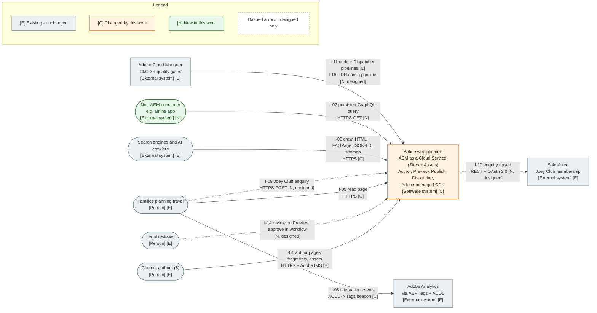
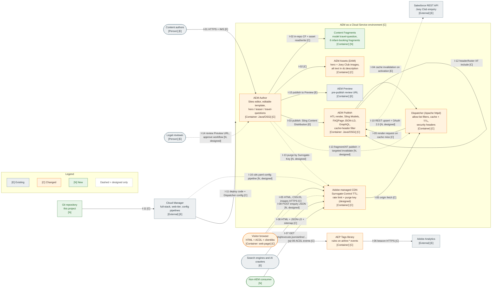
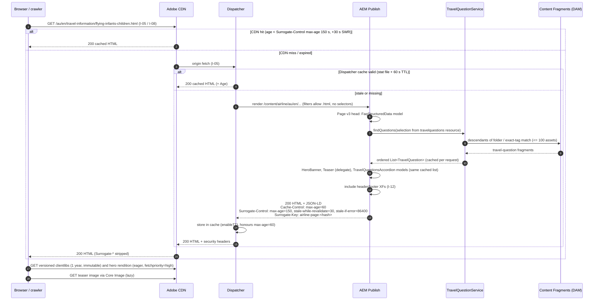
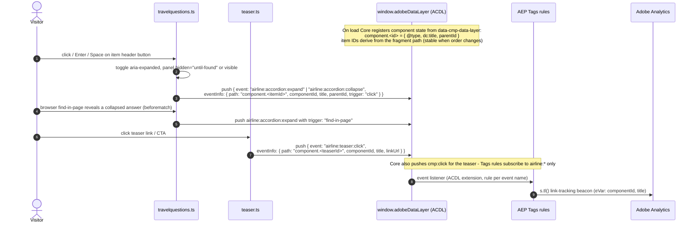
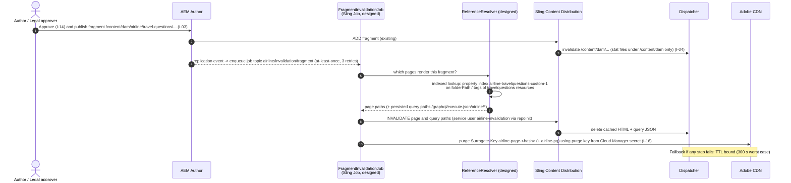
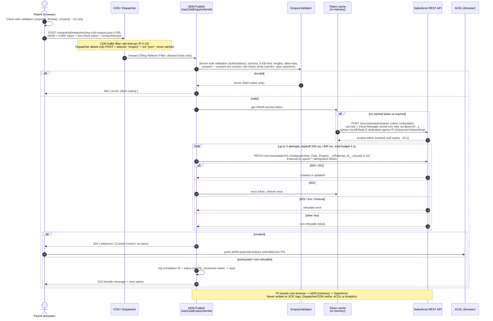
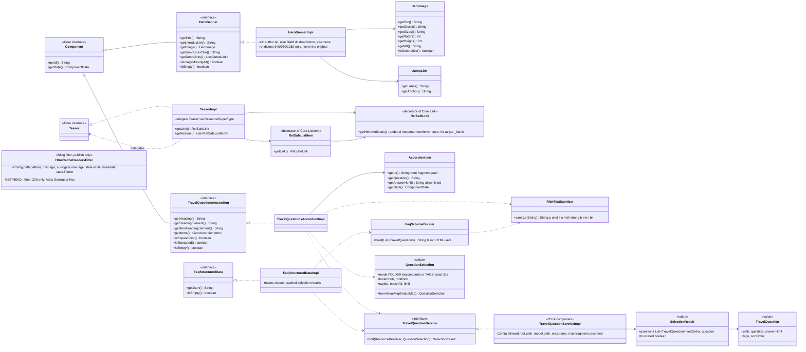
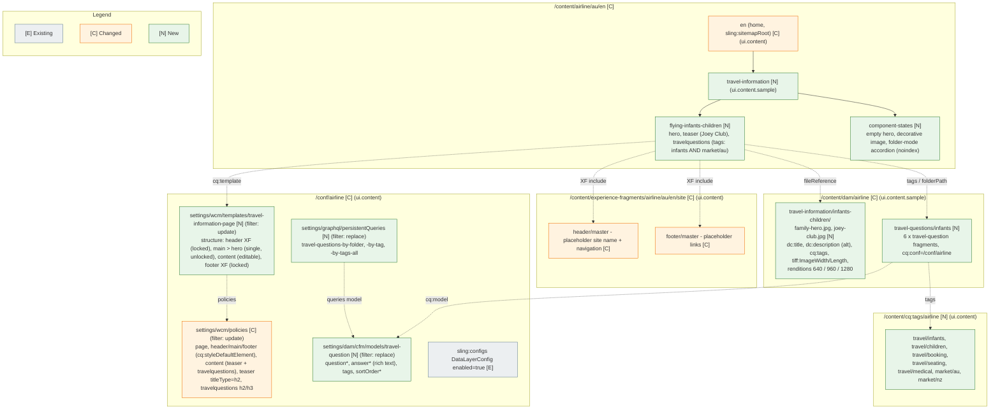

# 02 — Technical design

This document is the engineering design behind `SOLUTION_DESIGN.md` (Part A). That file is the client-facing architecture. This one says how each requirement is implemented, so a reviewer can trace a decision to code. Integration numbers (`I-xx`), ADR numbers and requirement IDs match the other documents. It is v1.1, updated after the architect review (`docs/03-architect-review.md`).

Diagram sources live in `docs/diagrams/*.mmd`. The Mermaid blocks below are copied from them by `scripts/sync-diagrams.ps1` (`-Check` fails CI on drift); edit the `.mmd` file, not this document. `scripts/render-diagrams.ps1` renders them to SVG in `docs/diagrams/rendered/`.

## 1. Architecture diagrams

### 1.1 C4 context (SD-02, SD-04)

<!-- diagram:c4-context -->

<!-- /diagram:c4-context -->

### 1.2 C4 container (SD-02, SD-04)

<!-- diagram:c4-container -->

<!-- /diagram:c4-container -->

### 1.3 Page render sequence (I-05, I-08, I-12)

<!-- diagram:sequence-page-render -->

<!-- /diagram:sequence-page-render -->

### 1.4 Data-layer events (DL-01, I-06)

<!-- diagram:sequence-datalayer -->

<!-- /diagram:sequence-datalayer -->

### 1.5 Fragment publish → page freshness (ADR-004, I-13 designed)

<!-- diagram:sequence-cf-invalidation -->

<!-- /diagram:sequence-cf-invalidation -->

### 1.6 Joey Club enquiry (SD-11, I-09/I-10, designed only)

<!-- diagram:sequence-joey-enquiry -->

<!-- /diagram:sequence-joey-enquiry -->

### 1.7 Sling Models and services (class view)

<!-- diagram:class-models -->

<!-- /diagram:class-models -->

### 1.8 Content / JCR structure (SD-07)

<!-- diagram:content-structure -->

<!-- /diagram:content-structure -->

## 2. Module layout

| Module | Contents added by this work |
|---|---|
| `core` | Sling Models (`models`, `models.impl`), `services` (`TravelQuestionService`), `filters.HtmlCacheHeadersFilter`, `structureddata.FaqSchemaBuilder`, `richtext.RichTextSanitizer`, unit tests and JaCoCo gate |
| `ui.apps` | Components `hero`, `travelquestions`; proxies `page`, `container`, `teaser`, `image`, `text`, `title`, `navigation`, `experiencefragment`, `xfpage`; HTL, dialogs; `clientlib-site` (from `ui.frontend`) |
| `ui.config` | `TravelQuestionServiceImpl` (all run modes); `HtmlCacheHeadersFilter` and CORS policy `CORSPolicyImpl~airline-graphql` (`config.publish`); resource-resolver mapping for short URLs (`config.publish`); log config |
| `ui.content` | **Code-owned structure:** template `travel-information-page` + policies (`mode="update"`); CF model `travel-question` and persisted queries (`mode="replace"`); tags `airline:` (`mode="merge"`); root folders |
| `ui.content.sample` (new, ADR-019) | **Demo content:** pages, XF content, six fragments, DAM images. Filter roots are explicit and use `mode="merge"`. Embedded in `all` for this exercise; excluded from production by dropping the embed |
| `ui.frontend` | `components/hero`, `components/teaser`, `components/travelquestions` (TypeScript + SCSS), `site/_layout.scss` (landmarks, skip link, responsive), data-layer helper. Node v24.22.3 / npm 11.19.1 (ADR-010) |
| `dispatcher` | `airline.vhost`, `airline.farm`, allow-list `filters.any`, cache rules, headers, `global.vars` (`DISABLE_DEFAULT_CACHING`, `CACHE_GRAPHQL_PERSISTED_QUERIES`), `clientheaders.any` (+ `Origin`) |
| `ui.tests` | Playwright + `@axe-core/playwright` suites (replaces the archetype's Cypress module) |

**Removed from the archetype:**
- The `helloworld` component and model, `SimpleServlet`, `SimpleScheduledTask`, `SimpleResourceListener`, `LoggingFilter`, and the CIF sample pages under `au/en`.
- Proxies this site does not use: accordion, carousel, tabs, `form/*`, contentfragment, contentfragmentlist, search, download, embed, pdfviewer, progressbar, separator, breadcrumb, languagenavigation, list, button. This also removes the risk of authors choosing the Core Accordion instead of the fragment-driven one.
- The matching SCSS for those proxies.

## 3. Components and dialogs

### 3.1 Hero banner — `airline/components/hero` (HB-01, HB-02, HB-03)

The hero is placed **in the template structure** as a single unlocked component, so a page has exactly one hero and one `h1` (ADR-020). Authors edit it but cannot add a second one.

| Dialog tab | Field | Property | Notes |
|---|---|---|---|
| Content | Title | `./jcr:title` | Required; the page's only `h1` |
| Content | Introduction | `./introduction` | Plain text, max 400 chars |
| Content | ID | `./id` | Optional HTML ID (Core convention) |
| Image | Image | `./fileReference` | Asset picker / drag-and-drop, root `/content/dam/airline` |
| Image | Image is decorative | `./isDecorative` | Hides the alt field; renders `alt=""` |
| Image | Alternative text | `./alt` | Optional. Blank → DAM `dc:description` (HB-02) |
| On this page | Heading | `./jumpLinksTitle` | Default "On this page" |
| On this page | Links (composite multifield) | `./jumpLinks/item*/label`, `./jumpLinks/item*/anchor` | Anchor normalised to `[a-z0-9-_]`; leading `#` stripped |

**Model.** `HeroBanner` interface (extends Core `Component`) → `HeroBannerImpl` (request-adaptable, JSON exporter).
- `isEmpty()` is true when the title is blank. HTL then renders only the editor placeholder in edit mode and nothing otherwise (HB-03).
- **Alt resolution:**
  - Decorative → `alt=""`.
  - Otherwise, the authored `alt`.
  - Otherwise, DAM `dc:description`.
  - Otherwise **no fallback to `dc:title`**. Asset titles are often file names, which are worse than nothing.

  If no alt resolves on a non-decorative image, `isImageMissingAlt()` is true: in edit mode the author sees a warning; on publish the image is **not rendered**. Text never depends on the image, so the page is still complete.
- **`srcset`** contains only `cq5dam.web.<w>.<h>.*` renditions (640, 960, 1280 from the `airline-web` processing profile), ordered by width, and **never the original** (AR-11). `src` = the 960 rendition. `sizes="(min-width: 1200px) 50vw, 100vw"`. `width`/`height` use the original's `tiff:` aspect ratio applied to the rendition width, falling back to the height in the rendition name. If two renditions share a width (the SDK's DAM workflow adds `cq5dam.web.1280.1280.jpeg`, which is 1280 px wide), the first by name is used. The local SDK has no asset microservices, so the sample package ships the 640/960/1280 renditions, built by `scripts/prepare-sample-images.ps1`.

**HTL.** `<section class="cmp-hero">` contains:
- `<h1>` and `<p>`
- ``
- `<nav aria-labelledby="…">` with a `<ul>` of `<a href="#anchor">`

The only conditions in HTL are `data-sly-test` on model booleans.

### 3.2 Teaser — `airline/components/teaser` (TS-01, TS-02, ADR-003)

Proxy: `sling:resourceSuperType = core/wcm/components/teaser/v2/teaser`.
- The dialog is inherited from Core: title, description, image, actions (`link`, `text`, `linkTarget`).
- Policy: `titleType=h2`, `showTitleType=false`, `pretitleHidden=true`, `imageDelegate=airline/components/image`, `actionsDisabled=false`.

**Model.** `TeaserImpl implements Teaser`, registered for `airline/components/teaser`. It gets the Core delegate with `@Self @Via(type = ResourceSuperType.class)`.
- Every method delegates except `getLink()` and `getActions()`. Those return `RelSafeLink` / `RelSafeListItem` decorators. When `target="_blank"`, `getHtmlAttributes()` adds `rel="noopener noreferrer"`, merged into any existing `rel` without duplicates.
- Verified against Core 2.28.0: `LinkImpl` emits only `href`, `target`, `aria-label` and `title`. A unit test fails if a future Core version starts emitting `rel` and we would duplicate it (R-05).
- Core HTL (`teaser.html`, `title.html`, `action.html`) is untouched. It resolves our model because it is registered for the more specific resource type.

### 3.3 Travel questions accordion — `airline/components/travelquestions` (AC-01, HD-01)

| Dialog field | Property | Notes |
|---|---|---|
| Section heading | `./heading` | e.g. "Booking for infants (under 2 years)" |
| ID | `./id` | Anchor target for hero jump links |
| Source | `./source` | Radio `folder` / `tags` (show/hide) |
| Folder | `./folderPath` | Pathfield under `/content/dam/airline/travel-questions` |
| Tags | `./tags` | Tag field (multiple), root `airline:` |
| Search root (tag mode) | `./rootPath` | Default `/content/dam/airline/travel-questions` |
| Match | `./tagMatch` | `any` / `all` |
| Maximum items | `./maxItems` | 1–20, default 20 |
| Expand first item | `./expandFirst` | Default false |

**Model.** `TravelQuestionsAccordion` (extends `Component`) → `TravelQuestionsAccordionImpl`.
- Builds `QuestionSelection.fromValueMap(properties)` and calls `TravelQuestionService.find`. The result is cached in a **request attribute** keyed by the selection, so `FaqStructuredData` reuses it (AR-22).
- Maps results to `AccordionItem`. The item ID is `ComponentUtils.generateId("travelquestions-item", fragmentPath)`, so analytics IDs stay stable when items are reordered (AR-20). Button/panel IDs are `<itemId>-button` / `<itemId>-panel`.
- Answer HTML passes through `RichTextSanitizer` (allow-list below) before rendering and before JSON-LD.
- Heading levels come from the policy (`headingElement`, default `h2`; `itemHeadingElement`, default `h3`), validated against `h2..h6`.
- Data-layer JSON per item: `@type airline/components/travelquestions/item`, `dc:title`, `parentId`.
- `isTruncated()` is true when the scan cap was hit. Edit mode shows a warning.

**HTL** follows the WAI-ARIA Authoring Practices accordion pattern:
- Header: `<hN><button type="button" aria-expanded="false" aria-controls="…-panel" id="…-button">`.
- Panel: `<div role="region" aria-labelledby="…-button" id="…-panel" hidden="until-found">`.

The collapsed state is rendered **on the server**, so there is no layout shift when JS initialises. `hidden="until-found"` (ADR-018) keeps answers in the DOM for crawlers and for find-in-page. Browsers without support treat it as `hidden`, which is the same collapsed behaviour. The `beforematch` event syncs `aria-expanded` and pushes an expand event with `trigger: "find-in-page"`.

**Empty state.** If no source is configured or no fragments match, edit mode shows the placeholder and publish renders nothing.

**`RichTextSanitizer`** is a small pure-Java allow-list (no extra dependency).
- Kept: `p, ul, ol, li, strong, b, em, i, br`, and `a` with `href` only, where `href` must be `https:`, `mailto:`, `tel:`, `/` or `#`.
- Removed: all other elements, keeping their text. All other attributes.

HTL then renders it with `context='html'` (AntiSamy) as defence in depth.

### 3.4 Page — `airline/components/page` (SE-01, SE-02, PT-02)

Core Page v3 proxy. `customheaderlibs.html` adds the FAQPage JSON-LD:

```html
<script type="application/ld+json" data-sly-use.faq="com.airline.travel.core.models.FaqStructuredData"
        data-sly-test="${!faq.empty}">${faq.json @ context='unsafe'}</script>
```

- **Why `context='unsafe'`.** HTL has no JSON context. Safety comes from serialisation: Gson's HTML-safe mode emits `<`, `>`, `&`, `=` and `'` as `\uXXXX`, and a unit test covers a `</script>` payload.
- **Where the data comes from.** `FaqStructuredDataImpl` finds `airline/components/travelquestions` resources under the page's `root` and reuses the request-cached selection.
- **Other page features.** Title, description, canonical (absolute via the Externalizer), robots, `hreflang` and the skip link (`mainContentSelector`) are Core Page features configured by policy and page properties.

### 3.5 Container and landmarks — `airline/components/container` (PT-02, ADR-008 revised)

This is the plain Core Container v1 proxy, with no overrides. Landmarks come from the Style System: the policy property `cq:styleDefaultElement` renders the component wrapper as `header` (header XF policy), `main` (main container policy) or `footer` (footer XF policy).
- The main container has `id="main-content"` in the template structure.
- The page policy sets `mainContentSelector=main-content`, so Core Page v3 renders the skip link.
- The header XF contains Core Navigation, which renders `<nav>`.

Playwright asserts one `<main>` containing `#main-content`, one `<header>` and one `<footer>`.

### 3.6 Experience fragments (PT-01, I-12)

- **Header:** the site name as a link, plus Core Navigation of `/content/airline/au/en` at depth 1. The archetype's language navigation and search are removed.
- **Footer:** a text component with copyright and placeholder links.

Both are included in the template structure as locked components. An XF publish updates page HTML within the TTL budget (≤ 300 s). Targeted invalidation via I-13 also covers XFs.

## 4. Services and OSGi configuration

| Service / component | Config PID | Properties | Run modes |
|---|---|---|---|
| `TravelQuestionServiceImpl` | `com.airline.travel.core.services.impl.TravelQuestionServiceImpl` | `allowed.root.path=/content/dam/airline/travel-questions`, `model.path=/conf/airline/settings/dam/cfm/models/travel-question`, `max.items=20`, `max.fragments.scanned=100` | all |
| `HtmlCacheHeadersFilter` | `com.airline.travel.core.filters.HtmlCacheHeadersFilter` | `path.pattern=^/content/airline/.*`, `max.age=60`, `surrogate.max.age=150`, `stale.while.revalidate=30`, `stale.if.error=86400` | `config.publish` only (`configurationPolicy=REQUIRE`) |
| CORS | `com.adobe.granite.cors.impl.CORSPolicyImpl~airline-graphql` | `alloworigin=[https://www.airline.example]`, `allowedpaths=[/graphql/execute.json/airline/.*]`, `supportedmethods=[GET,HEAD,OPTIONS]`, `supportscredentials=false` | `config.publish` |
| Resource resolver mapping | `org.apache.sling.jcr.resource.internal.JcrResourceResolverFactoryImpl` | `resource.resolver.mapping=[/content/airline/</]` | `config.publish` |
| Log config | `org.apache.sling.commons.log.LogManager.factory.config~airline` | `com.airline` at INFO | all |

**`HtmlCacheHeadersFilter` scope (AR-23).**
- It is a Sling request filter, applied only to `GET`/`HEAD` requests with the `html` extension whose path matches `path.pattern`.
- It does not apply in author run mode: the config exists only in `config.publish`.
- It wraps the response and sets headers **lazily on the first write or commit**, and only if the status is 200. `Cache-Control` is never added to 404/500 responses or redirects.
- `Surrogate-Key` = `airline-page-` + the first 12 hex characters of SHA-256 of the page path. I-13 purges by this key.

**Why a filter rather than Dispatcher `mod_headers`.** Dispatcher's `enableTTL` reads `Cache-Control`/`Expires` from the **AEM response**. Headers added by `mod_headers` happen after caching and are invisible to it. Emitting them in AEM is the only way for one value to drive both the Dispatcher TTL and the CDN.

**Fragment selection logic (`TravelQuestionServiceImpl`).** This semantic is shared with the persisted queries (AR-02); see `SOLUTION_DESIGN.md` §8.1.
1. **Validate.** `folderPath` / `rootPath` must be equal to or below `allowed.root.path`, otherwise the result is empty with a WARN log. This stops authors pointing at arbitrary DAM trees.
2. **Walk.** Depth-first walk of descendants of the folder (folder mode) or of `rootPath` (tag mode). Only `sling:Folder`/`sling:OrderedFolder`/`nt:folder` nodes are descended into; `dam:Asset` nodes are visited but not entered. The walk stops after **`max.fragments.scanned` = 100** assets; if it stops early, `truncated=true` and a WARN log is written.
3. **Filter by model.** Each asset is adapted to `ContentFragment` and kept only if `jcr:content/data/@cq:model` equals `model.path`.
4. **Tag mode.** The fragment's `tags` element values are compared to the selected tag IDs by **exact ID**. *Any* = at least one match; *all* = every selected tag present. Child tags do not match their parent, and asset `cq:tags` is ignored. This matches what GraphQL can express.
5. **Required fields.** Fragments with a blank `question` or `answer` are skipped. The model marks both required, so this only guards against inconsistent data.
6. **Sort and limit.** Sort by `sortOrder` (required; missing = `Integer.MAX_VALUE` as defence), then `question` with case-sensitive `String.compareTo`. That is the same order as the GraphQL `sort: "sortOrder ASC, question ASC"`. The limit is min(dialog max, `max.items`).

No JCR query is used, so there is no index dependency and the cost is predictable. The service reads with the **request's resolver**: anonymous on publish, with `everyone` read on `/content/dam`. No service user is needed in the built scope; I-13 introduces `airline-invalidation`.

## 5. Template and policy strategy (PT-01)

- **Template.** One editable template, `travel-information-page`, based on the archetype `page` template type. Structure: header XF (policy element `header`, locked), main container (policy element `main`, `id=main-content`) containing the hero (unlocked, single) and `content` (unlocked), and footer XF (policy element `footer`, locked).
- **Policies.** Stored in `/conf/airline/settings/wcm/policies` and named by purpose (`airline-content`, `airline-teaser-joeyclub`, and so on). The NZ live copy reuses them because it shares `/conf/airline`.
- **Allowed components.** The `content` container allows **only** `airline/components/teaser` and `airline/components/travelquestions`.
- **Templates on new pages.** `cq:allowedTemplates` on `/content/airline` restricts new pages to this template.
- **FileVault modes.** Templates and policies use `mode="update"`, so changes deploy to existing environments while authored nodes outside the package stay intact. The CF model and persisted queries use `mode="replace"`.

## 6. Content structure and URLs

See §1.8. Demo content ships in `ui.content.sample` (EN-02).

| Path | Content |
|---|---|
| `/content/airline/au/en` | Home. `sling:sitemapRoot=true` |
| `…/travel-information/flying-infants-children` | Full page. Accordion in **tag mode, all**: `airline:travel/infants` + `airline:market/au` |
| `…/travel-information/component-states` | Folder-mode accordion; hero with no image; decorative image; empty-state accordion. Robots `noindex` |
| `/content/dam/airline/travel-questions/infants/*` | Six fragments (titles from the reference page; our own copy), each tagged `travel/infants` + `market/au` + `market/nz` |
| `/content/dam/airline/travel-information/infants-children/` | `family-hero.jpg`, `joey-club.jpg` with `dc:description` and renditions 640/960/1280 |
| `/conf/airline/settings/graphql/persistentQueries/` | `travel-questions-by-folder`, `travel-questions-by-tag`, `travel-questions-by-tags-all` |

**URLs (AR-14).**
- **Public URL:** `/au/en/travel-information/flying-infants-children.html`. The publish resource-resolver mapping shortens links in HTML, and the archetype's Dispatcher rewrite (`/content/airline` prefix) resolves incoming requests.
- **Canonical:** absolute via the Externalizer `publish` domain. Locally the domain is `http://localhost:4503`.
- **Sitemap:** the Apache Sling Sitemap generator on `au/en`, exposed as `/au/en.sitemap.xml` and allowed in Dispatcher filters.
- **robots.txt:** Q-05.

## 7. Persisted queries (HD-02)

There are three queries, one per selection pattern the pages use. They share the Java semantic in §4.

```graphql
query TravelQuestionsByTagsAll($audience: String!, $market: String!, $limit: Int = 20) {
  travelQuestionList(
    filter: {
      _logOp: AND
      tags: {
        _logOp: AND
        _expressions: [
          { value: $audience, _operator: EQUALS, _apply: AT_LEAST_ONCE }
          { value: $market,   _operator: EQUALS, _apply: AT_LEAST_ONCE }
        ]
      }
    }
    sort: "sortOrder ASC, question ASC"
    limit: $limit
  ) {
    items { _path question answer { html plaintext } tags sortOrder }
  }
}
```

The other two queries:
- `travel-questions-by-folder` filters `_path` with `STARTS_WITH $folder` (with a trailing `/`).
- `travel-questions-by-tag` uses one tag expression.

**Requests.** Variables are URL-encoded:

```
GET /graphql/execute.json/airline/travel-questions-by-tags-all;audience=airline%3Atravel%2Finfants;market=airline%3Amarket%2Fau
```

**Caching.**
- Each query's cache config sets `cache-control: max-age=60` and `surrogate-control: max-age=150, stale-while-revalidate=30, stale-if-error=86400`, the same budget as HTML.
- Dispatcher caches persisted queries via `CACHE_GRAPHQL_PERSISTED_QUERIES`.
- CORS: see §4. `Origin` is in `clientheaders.any`, so the header reaches AEM.

**Contract test (R-08).** Playwright compares the persisted-query JSON `question` list with the accordion button labels on the demo page, in order.

## 8. Front-end approach

- **No framework.** TypeScript modules in `ui.frontend`, bundled by the archetype webpack into the `airline.site` clientlib. The JS bundle stays under 15 KB compressed.
- **`travelquestions.ts`.**
  - The server renders the collapsed state (and `expandFirst`).
  - JS handles `click` on the buttons. Enter and Space activate native `<button>` elements, so there is no custom key handling.
  - It toggles `aria-expanded`/`hidden`, listens for `beforematch`, and pushes `airline:accordion:expand|collapse` with `trigger`.
- **`teaser.ts`.**
  - A delegated `click` listener on links inside `.cmp-teaser` within `airline/components/teaser` instances.
  - It reads ID and title from `data-cmp-data-layer` (fallback: the element `id` and the `.cmp-teaser__title` text).
  - It pushes `airline:teaser:click`.
- **`datalayer.ts`.** `pushEvent(name, eventInfo)` is the single helper. It guards `window.adobeDataLayer = window.adobeDataLayer || []`.
- **CSS.**
  - Mobile-first SCSS with BEM `cmp-*` classes. Breakpoints at 768 px and 1200 px; checked at 375 px and 1280 px.
  - `:focus-visible` outline with 3:1 contrast; `prefers-reduced-motion` respected; skip link visible on focus.
  - System fonts only, so there are no web-font requests.

## 9. Testing strategy

| Layer | Tooling | Scope |
|---|---|---|
| Unit (EN-03) | JUnit 5, wcm.io AEM Mocks, Mockito, Core Components test context | Every Sling Model, `TravelQuestionServiceImpl` (folder descendants, tags any/all, exact-ID, limit, order, invalid paths, cap/truncation, model mismatch), `FaqSchemaBuilder` (shape, escaping), `RichTextSanitizer`, `HtmlCacheHeadersFilter` (method/extension/status/lazy), `RelSafeLink` (no duplicate `rel`) |
| Coverage | JaCoCo `check` at **80 % line coverage** for `core` | The build fails below the threshold |
| UI (EN-04) | Playwright (system Edge) + `@axe-core/playwright` against publish | Accordion keyboard and ARIA; data-layer events; axe (0 serious/critical); one `h1`; one `main#main-content`; skip link; persisted-query contract; 375/1280 screenshots; no console errors (EN-06) |
| Performance (PF-01) | Lighthouse CLI, mobile preset, on **publish** (A-04) | LCP, CLS, TBT, transfer size vs SD-08 |
| Structured data (SE-01) | Unit test + rendered JSON-LD parsed in Playwright | `FAQPage` → `Question` → `acceptedAnswer` |
| Dispatcher (DP-01) | `scripts/check-dispatcher.ps1` (`enabled_*` copies identical to `available_*`, no default filters); SDK validator in the Cloud Manager web-tier pipeline (R-02) | Filters, cache, vhost |
| Docs | `scripts/sync-diagrams.ps1 -Check`, `scripts/check-traceability.ps1` | Diagrams and `I-xx` consistency |

## 10. Security considerations

- **Dispatcher allow-list** (archetype `default_filters.any` not included). It denies everything, then allows:
  - `GET` `.html` without selectors under `/content/airline` (and the short `/au`, `/nz` paths after rewrite).
  - `/etc.clientlibs/*`.
  - Image renditions under `/content/dam/airline/*/jcr:content/renditions/cq5dam.web.*`, plus originals of image types.
  - `.coreimg.` image selectors.
  - `GET` `/graphql/execute.json/airline/*`.
  - `.sitemap.xml` / `.sitemap-index.xml` on `/content/airline`.
  - The CSRF token and favicons.

  It still denies `model.json` and `infinity.json` on publish (author access for verification is direct on 4502), `wcmmode`/`debug` query strings, and all `POST`s. The enquiry `POST` is designed but not enabled.
- **Output encoding.** HTL default contexts everywhere. Answers are allow-list sanitised, then rendered with `context='html'`. JSON-LD is escaped by serialisation. Jump-link anchors are normalised server-side.
- **No write paths and no servlets** in the built scope.
- **Headers.** Values and owners (CDN vs Dispatcher) are in `SOLUTION_DESIGN.md` §7. `X-Frame-Options` is set exactly once.
- **CSP.** The baseline is enforced. A hash-based `script-src` runs report-only (R-07).
- **Secrets** (designed scope): Cloud Manager secret variables only.

## 11. Performance considerations

- **Hero image.** The browser picks from 640/960/1280 renditions using `srcset`/`sizes`. The ≤ 150 KB budget applies to the 960 w rendition selected at 412 px × 1.75 DPR. `width`/`height` are set to avoid layout shift.
- **Loading order.** JS at the end of body (page policy); CSS in head; system fonts.
- **Server work.** JSON-LD and the accordion share one service call per selection per request (request attribute). The scan is capped at 100 assets.
- **HTML caching.** Dispatcher TTL 60 s, CDN 150 s + 30 s SWR, browser 60 s; ≤ 300 s worst case. Versioned clientlibs are cached for 1 year. DAM renditions are cached for 1 day.
- **No client-side fragment fetch** (ADR-004 option d rejected), so content is in the first HTML byte.
