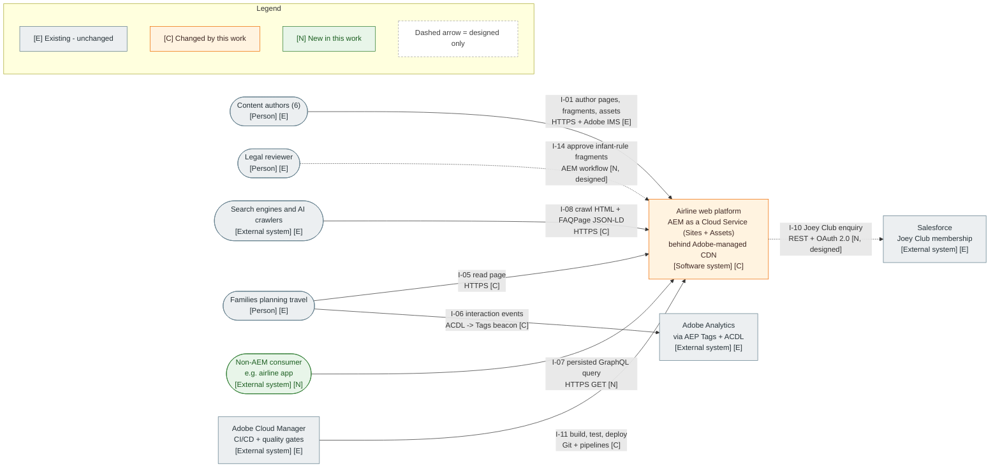
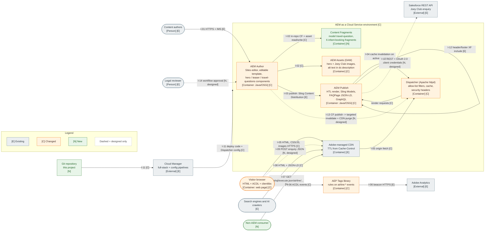
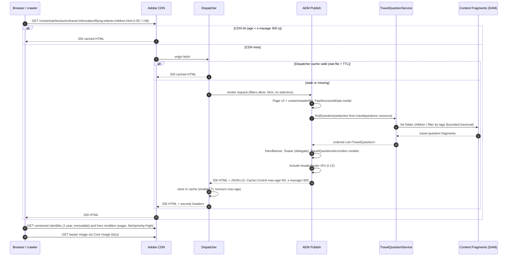
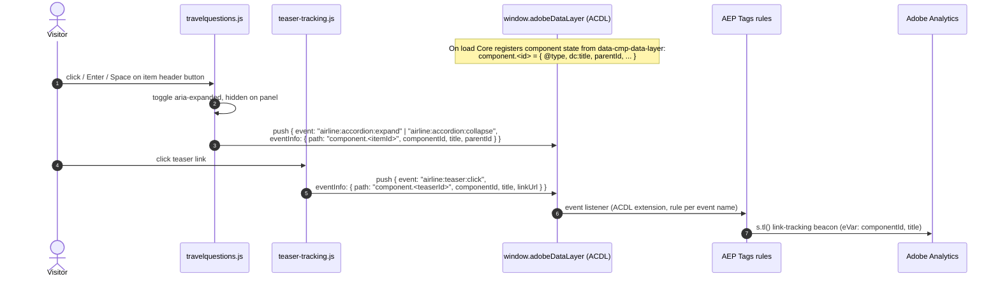
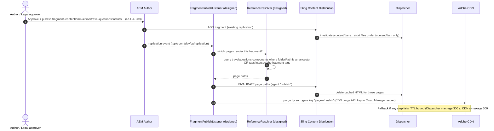
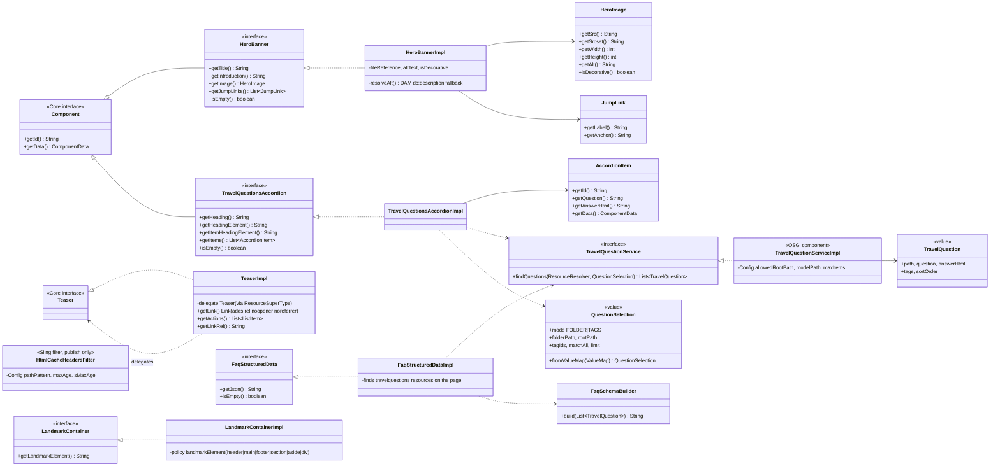
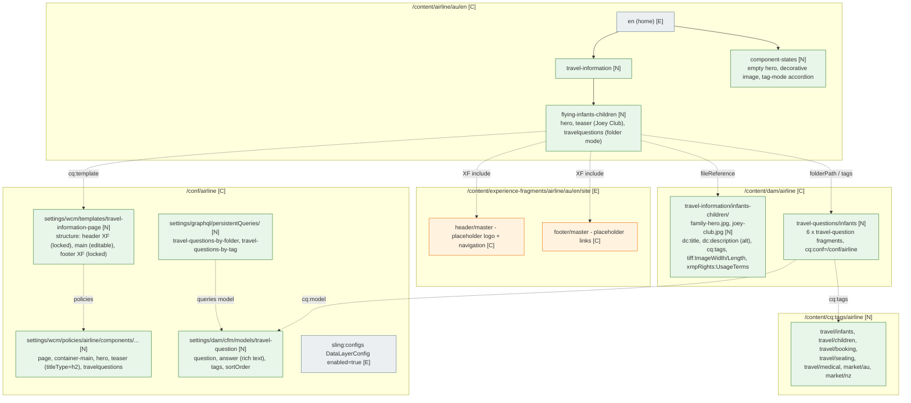

# 02 — Technical design

This document is the engineering design behind `SOLUTION_DESIGN.md` (Part A). That file is the client-facing architecture. This one says how each requirement is implemented, so a reviewer can trace a decision to code. Integration numbers (`I-xx`), ADR numbers and requirement IDs match the other documents.

Diagram sources live in `docs/diagrams/*.mmd`. The Mermaid blocks below are copied from them by `scripts/sync-diagrams.ps1`; edit the `.mmd` file, not this document. `scripts/render-diagrams.ps1` renders them to SVG in `docs/diagrams/rendered/`.

## 1. Architecture diagrams

### 1.1 C4 context (SD-02, SD-04)

<!-- diagram:c4-context -->

<!-- /diagram:c4-context -->

### 1.2 C4 container (SD-02, SD-04)

<!-- diagram:c4-container -->

<!-- /diagram:c4-container -->

### 1.3 Page render sequence (I-05, I-08, I-12)

<!-- diagram:sequence-page-render -->

<!-- /diagram:sequence-page-render -->

### 1.4 Data-layer events (DL-01, I-06)

<!-- diagram:sequence-datalayer -->

<!-- /diagram:sequence-datalayer -->

### 1.5 Fragment publish → page freshness (ADR-004, I-13 designed)

<!-- diagram:sequence-cf-invalidation -->

<!-- /diagram:sequence-cf-invalidation -->

### 1.6 Joey Club enquiry (SD-11, I-09/I-10, designed only)

<!-- diagram:sequence-joey-enquiry -->
```mermaid
%% SD-11 Joey Club enquiry (designed only). Integrations I-09 (browser -> AEM) and I-10 (AEM -> Salesforce).
sequenceDiagram
    autonumber
    actor U as Parent (browser)
    participant CDN as CDN / Dispatcher
    participant S as AEM Publish<br/>JoeyClubEnquiryServlet
    participant V as EnquiryValidator
    participant T as Token cache<br/>(in-memory)
    participant SF as Salesforce REST API
    participant DL as ACDL (browser)

    U->>U: Client-side validation (required, formats, consent) - UX only
    U->>CDN: POST /content/airline/au/en/joey-club.enquiry.json (I-09)<br/>JSON + CSRF token + bot-check token
    Note over CDN: Filter allows only POST + selector "enquiry" + ext "json"<br/>never cached; CDN rate limit rule per IP
    CDN->>S: forward
    S->>V: Server-side validation (authoritative): schema, lengths, allow-lists, consent, bot-check verify
    alt invalid
        V-->>S: errors (field codes only)
        S-->>U: 400 { errors: [field codes] }
    else valid
        S->>T: get OAuth access token
        alt no cached token or expired
            T->>SF: POST /oauth2/token (client credentials)<br/>client id/secret from Cloud Manager secret env vars via OSGi $[secret:...]
            SF-->>T: access token (cached until expiry - 60 s)
        end
        loop up to 3 attempts, backoff 200 ms / 800 ms, total budget 4 s
            S->>SF: POST /services/data/vXX.X/sobjects/Joey_Club_Enquiry__c (I-10)<br/>Idempotency key = UUID per submission
            alt 2xx
                SF-->>S: 201 { id }
            else 401
                S->>T: evict token, refresh once
            else 429 / 5xx / timeout
                SF-->>S: retryable error
            else other 4xx
                SF-->>S: non-retryable (stop)
            end
        end
        alt created
            S-->>U: 202 { reference }
            U->>DL: push airline:joeyclub:enquiry-submitted (no PII)
        else exhausted / non-retryable
            S->>S: log correlation ID + status (no PII), increment metric -> alert
            S-->>U: 503 friendly message + retry option
        end
    end
    Note over S,SF: PII travels only browser -> AEM (memory) -> Salesforce.<br/>Never written to JCR, logs, Dispatcher/CDN cache, ACDL or Analytics.
```
<!-- /diagram:sequence-joey-enquiry -->

### 1.7 Sling Models and services (class view)

<!-- diagram:class-models -->

<!-- /diagram:class-models -->

### 1.8 Content / JCR structure (SD-07)

<!-- diagram:content-structure -->

<!-- /diagram:content-structure -->

## 2. Module layout

| Module | Contents added by this work |
|---|---|
| `core` | Sling Models (`models`, `models.impl`), `services` (`TravelQuestionService`), `filters.HtmlCacheHeadersFilter`, `structureddata.FaqSchemaBuilder`, unit tests and JaCoCo gate |
| `ui.apps` | Components `hero`, `travelquestions`; proxies `page`, `container` (landmark element), `teaser`; HTL, dialogs, design dialogs; `clientlib-site` (from `ui.frontend`) |
| `ui.config` | `TravelQuestionServiceImpl` config (all run modes); `HtmlCacheHeadersFilter` config (`config.publish`); repoinit; log config |
| `ui.content` | Template `travel-information-page` + policies; CF model `travel-question`; persisted queries; tags; DAM images with metadata and renditions; six fragments; demo pages; placeholder XFs |
| `ui.frontend` | `components/hero`, `components/teaser`, `components/travelquestions` (TypeScript + SCSS), `site/_layout.scss` (landmarks, skip link, responsive), data-layer helper |
| `dispatcher` | `airline.vhost`, `airline.farm`, `filters.any` allow-list, `rules.any`, headers, `global.vars` (`CACHE_GRAPHQL_PERSISTED_QUERIES`) |
| `ui.tests` | Playwright + `@axe-core/playwright` suites (replaces the archetype's Cypress module) |

Removed archetype samples: `helloworld` component/model, `SimpleServlet`, `SimpleScheduledTask`, `SimpleResourceListener`, `LoggingFilter`, and the CIF sample pages left under `au/en`. These are dead code, and Cloud Manager would scan them.

## 3. Components and dialogs

### 3.1 Hero banner — `airline/components/hero` (HB-01, HB-02, HB-03)

| Dialog tab | Field | Property | Notes |
|---|---|---|---|
| Content | Title | `./jcr:title` | Required; rendered as the page's only `h1` |
| Content | Introduction | `./introduction` | Plain text, max 400 chars |
| Content | ID | `./id` | Optional HTML ID (Core convention) |
| Image | Image | `./fileReference` | Asset picker / drag-and-drop from DAM, root `/content/dam/airline` |
| Image | Image is decorative | `./isDecorative` | Hides the alt field; renders `alt=""` |
| Image | Alternative text | `./alt` | Optional. Blank → DAM `dc:description` (HB-02) |
| On this page | Heading | `./jumpLinksTitle` | Default "On this page" |
| On this page | Links (multifield, composite) | `./jumpLinks/item*/label`, `./jumpLinks/item*/anchor` | Anchor normalised to `[a-z0-9-_]`; leading `#` stripped |

**Model.** `HeroBanner` interface (extends Core `Component`) → `HeroBannerImpl` (request-adaptable, `@Exporter` JSON). Behaviour:
- `isEmpty()` is true when the title is blank. HTL then renders only Core's `templates.placeholder` in edit mode and nothing otherwise (HB-03).
- `getImage()` returns a `HeroImage` (src, srcset, width, height, alt, decorative), or `null` when there is no valid asset.
- Alt resolution (`resolveAlt`): if decorative, `""`; otherwise authored `alt`, then DAM `dc:description`, then DAM `dc:title`. The final fallback avoids an empty alt on a meaningful image, and the author is warned in edit mode.
- `srcset` is built from `cq5dam.web.<w>.<h>.*` renditions present on the asset, ordered by width, plus the original with its `tiff:ImageWidth`. `width`/`height` come from asset metadata.

**HTL.** `<section class="cmp-hero">` → `<h1>` + `<p>` + `` + `<nav aria-labelledby="…">` with `<ul>` of `<a href="#anchor">`. No conditions in HTL beyond `data-sly-test` on model booleans.

### 3.2 Teaser — `airline/components/teaser` (TS-01, TS-02, ADR-003)

Proxy: `sling:resourceSuperType = core/wcm/components/teaser/v2/teaser`. The dialog is inherited from Core: title, description (rich text), image, actions with `link`, `text`, `linkTarget`. The design dialog is also inherited, and the policy sets `titleType=h2`, `showTitleType=false`, `pretitleHidden=true`, `imageDelegate=airline/components/image`, `actionsDisabled=false`.

**Model.** `TeaserImpl implements Teaser`, `@Model(adaptables = SlingHttpServletRequest.class, adapters = Teaser.class, resourceType = "airline/components/teaser")`. It gets the Core delegate with `@Self @Via(type = ResourceSuperType.class)`.
- Every method delegates, except `getLink()` and `getActions()`. Those return decorators (`RelSafeLink`, `RelSafeListItem`) that add `rel="noopener noreferrer"` to `getHtmlAttributes()` when `target="_blank"`. Core's `LinkImpl` only emits `href`/`target`/`aria-label`/`title`, which is why this decoration is needed.
- Core HTL (`teaser.html`, `title.html`, `action.html`) stays untouched. `data-sly-use.teaser="…models.Teaser"` resolves to our model because it is registered for the more specific resource type.

### 3.3 Travel questions accordion — `airline/components/travelquestions` (AC-01, HD-01)

| Dialog field | Property | Notes |
|---|---|---|
| Section heading | `./heading` | e.g. "Booking for infants (under 2 years)" |
| ID | `./id` | Anchor for hero jump links |
| Source | `./source` | Radio `folder` / `tags` (show/hide) |
| Folder | `./folderPath` | Pathfield under `/content/dam/airline/travel-questions` |
| Tags | `./tags` | Tag field (multiple), root `airline:travel` |
| Search root (tag mode) | `./rootPath` | Default `/content/dam/airline/travel-questions` |
| Match | `./tagMatch` | `any` / `all` |
| Maximum items | `./maxItems` | 1–20, default 20 |
| Expand first item | `./expandFirst` | Default false |

**Model.** `TravelQuestionsAccordion` (extends `Component`) → `TravelQuestionsAccordionImpl`:
- Builds `QuestionSelection.fromValueMap(properties)` and calls `TravelQuestionService.findQuestions`.
- Maps results to `AccordionItem` with stable IDs `<componentId>-item-<n>`, and button/panel IDs `<itemId>-button` / `<itemId>-panel`.
- Heading levels come from the policy (`headingElement`, default `h2`; `itemHeadingElement`, default `h3`), validated against `h2..h6`.
- Exposes data-layer JSON per item (`@type airline/components/travelquestions/item`, `dc:title`, `parentId`).

**HTL** follows the WAI-ARIA Authoring Practices accordion pattern: `<hN class="cmp-travelquestions__item-heading"><button type="button" aria-expanded="false" aria-controls="…-panel" id="…-button">` and `<div role="region" aria-labelledby="…-button" id="…-panel" hidden="until-found">`. The collapsed state is rendered **on the server**, so there is no layout shift when JS initialises (CLS). `hidden="until-found"` keeps answers in the HTML for crawlers and lets browser find-in-page reveal them; the `beforematch` event syncs `aria-expanded`. Answers are also in the HTML and the JSON-LD regardless of the expanded state.

**Empty state.** No source configured, or no fragments → editor placeholder in edit mode, nothing on publish.

### 3.4 Page — `airline/components/page` (SE-01, SE-02, PT-02)

Core Page v3 proxy (archetype). `customheaderlibs.html` adds the FAQPage JSON-LD:

```html
<script type="application/ld+json" data-sly-use.faq="com.airline.travel.core.models.FaqStructuredData"
        data-sly-test="${!faq.empty}">${faq.json @ context='unsafe'}</script>
```

`context='unsafe'` is used because HTL has no JSON context. Safety comes from serialisation: Gson HTML-escaping emits `<`, `>`, `&`, `=` and `'` as `\uXXXX`, and that is unit-tested with a `</script>` payload. Title, description, canonical (`cq:canonicalUrl`, default self), robots and the skip link (`mainContentSelector` page policy) are Core Page features configured by policy and page properties.

### 3.5 Container — `airline/components/container` (PT-02, ADR-008)

Proxy of Core Container v1, overriding `responsiveGrid.html` and `simple.html` to use `data-sly-element="${container.landmarkElement}"`. That value comes from a small `LandmarkContainer` model reading the policy property `landmarkElement` (`div|header|main|footer|section|aside`; anything else falls back to `div`). The template structure sets `header`, `main` (with `id=main-content`) and `footer` containers. The header XF contains Core Navigation, which renders `<nav>`.

### 3.6 Experience fragments (PT-01)

Placeholder header (site name as a link, plus Core Navigation of `/content/airline/au/en` at depth 1) and footer (a text component with copyright and placeholder links). Both are included in the template structure as locked components.

## 4. Services and OSGi configuration

| Service / component | Config PID | Properties | Run modes |
|---|---|---|---|
| `TravelQuestionServiceImpl` | `com.airline.travel.core.services.impl.TravelQuestionServiceImpl` | `allowed.root.path=/content/dam/airline/travel-questions`, `model.path=/conf/airline/settings/dam/cfm/models/travel-question`, `max.items=20`, `max.traversal=200` | all |
| `HtmlCacheHeadersFilter` | `com.airline.travel.core.filters.HtmlCacheHeadersFilter` | `path.pattern=^/content/airline/.*`, `max.age=60`, `s.maxage=300`, `stale.while.revalidate=300`, `stale.if.error=86400` | `config.publish` only (component has `configurationPolicy=REQUIRE`) |
| Log config | `org.apache.sling.commons.log.LogManager.factory.config~airline` | `com.airline` at INFO (archetype) | all; DEBUG in `config.dev` only if needed |

**Fragment selection logic (`TravelQuestionServiceImpl`).**
1. Validate: the folder/root path must sit under `allowed.root.path`, which prevents authors pointing the accordion at arbitrary DAM trees. Tag IDs are resolved through `TagManager` and unknown tags are ignored.
2. Folder mode: iterate direct children of the folder. Tag mode: depth-first traversal under `rootPath`, capped at `max.traversal` nodes.
3. For each `dam:Asset`, adapt to `ContentFragment`. Keep it if its `cq:model` matches `model.path` (when the property is present) and `question`/`answer` are not blank.
4. Tag mode: compare the fragment's `tags` element (and asset `cq:tags`) using any/all semantics. Tags are compared by tag ID, with child tags matching their parent (`airline:travel/infants` matches `airline:travel`).
5. Sort by `sortOrder` (missing = `Integer.MAX_VALUE`), then question (case-insensitive). Apply `limit` = min(dialog max, `max.items`).

No JCR query is used, so there is no index dependency and no traversal warnings, with a predictable cost (≤ 200 nodes). The service reads with the **request's resolver**: anonymous on publish, with the existing `everyone` read on `/content/dam`. No service user is needed.

## 5. Template and policy strategy (PT-01)

- One editable template, `travel-information-page`, from the archetype `page` template type. Only `root/main/content` is unlocked.
- Policies are stored in `/conf/airline/settings/wcm/policies` and named by purpose (`airline-content`, `airline-teaser-joeyclub`, and so on), so the NZ live copy (same `/conf`) reuses them.
- The content container allows **only** `airline/components/hero`, `airline/components/teaser` and `airline/components/travelquestions`.
- The template is enabled, and `cq:allowedTemplates` on `/content/airline` restricts new pages to it.

## 6. Content structure

See §1.8. Sample content shipped in `ui.content` (EN-02):
- `/content/airline/au/en/travel-information/flying-infants-children`: the full page.
- `/content/airline/au/en/travel-information/component-states`: hero with no image, decorative image, accordion in tag mode, and an empty hero to show the placeholder. `noindex` robots.
- `/content/dam/airline/travel-questions/infants/*`: six fragments (titles from the reference page; our own copy).
- `/content/dam/airline/travel-information/infants-children/family-hero.jpg`, `joey-club.jpg`: with `dc:description`, renditions 640 and 1280.
- `/conf/airline/settings/graphql/persistentQueries/travel-questions-by-folder` and `travel-questions-by-tag`.

FileVault filters use `mode="merge"` for content roots, so author edits survive redeploys, and `mode="replace"` for the model and persisted queries, which are owned by code.

## 7. Persisted queries (HD-02)

```graphql
query TravelQuestionsByFolder($path: String!) {
  travelQuestionList(
    filter: { _path: { _expressions: [{ value: $path, _operator: STARTS_WITH }] } }
    sort: "sortOrder ASC, question ASC"
  ) {
    items { _path question answer { html plaintext } tags sortOrder }
  }
}
```

`travel-questions-by-tag` filters `tags` with `_operator: CONTAINS`, `_apply: AT_LEAST_ONCE`. Request: `GET /graphql/execute.json/airline/travel-questions-by-folder;path=/content/dam/airline/travel-questions/infants/`. Cache headers are set in the query definition (`cache-control: max-age=60`, `surrogate-control: max-age=300`).

## 8. Front-end approach

- **No framework.** TypeScript modules in `ui.frontend`, bundled by the archetype webpack into the `airline.site` clientlib. The JS bundle stays under 15 KB compressed.
- `travelquestions.ts`: the server renders the collapsed state (and `expandFirst`). JS handles `click` on the buttons; Enter and Space activate native `<button>` elements, so there is no custom key handling and no `keydown` duplication. It toggles `aria-expanded`/`hidden`, listens for `beforematch` (find-in-page), and pushes `airline:accordion:expand|collapse`.
- `teaser.ts`: delegated `click` listener on `.cmp-teaser a` inside `airline/components/teaser` instances. It reads ID and title from `data-cmp-data-layer` (fallback: the element's `id` and `.cmp-teaser__title` text) and pushes `airline:teaser:click`.
- `datalayer.ts`: `pushEvent(name, eventInfo)` is the single helper. It guards `window.adobeDataLayer = window.adobeDataLayer || []`.
- **CSS:** mobile-first SCSS, BEM `cmp-*` classes. Breakpoints at 768 px and 1200 px (matching the template's responsive grid). The layout is checked at 375 px and 1280 px. Focus is visible (`:focus-visible` outline with 3:1 contrast), and `prefers-reduced-motion` is respected.
- **Skip link** (Core page) is styled visible on focus.
- **Images:** the hero is eager with `fetchpriority=high`. The teaser uses Core Image v3, which is lazy by default.

## 9. Testing strategy

| Layer | Tooling | Scope |
|---|---|---|
| Unit (EN-03) | JUnit 5, wcm.io AEM Mocks 5.5.4, Mockito, Core Components AEM-mock plugin | Every Sling Model (`HeroBannerImpl`, `TeaserImpl`, `TravelQuestionsAccordionImpl`, `FaqStructuredDataImpl`, `LandmarkContainerImpl`), `TravelQuestionServiceImpl` (folder/tag/any/all/limit/order/invalid paths), `FaqSchemaBuilder` (schema shape, escaping), `HtmlCacheHeadersFilter`, `QuestionSelection` |
| Coverage | JaCoCo, `check` goal at **80 % line coverage** for `core` | The build fails below the threshold and on any test failure (surefire default) |
| UI (EN-04) | Playwright (system Edge/Chrome) + `@axe-core/playwright` | Accordion keyboard (Tab to button, Enter/Space toggle, `aria-expanded`, `aria-controls` target), data-layer events for expand, collapse and teaser click, axe scan (no serious/critical), landmarks + skip link, 375/1280 layout screenshots, no console errors (EN-06) |
| Performance (PF-01) | Lighthouse CLI, mobile preset, on `?wcmmode=disabled` | LCP, CLS, TBT (INP proxy), transfer size vs SD-08 |
| Structured data (SE-01) | Unit test on JSON shape + the rendered page's JSON-LD checked against the Schema.org validator | FAQPage, Question, Answer |
| Dispatcher (DP-01) | SDK validator (`bin/validate.sh src`) — see limitation R-02 | Filters, cache, vhost |

## 10. Security considerations

- **Dispatcher allow-list** (does not include the archetype `default_filters.any`). It allows:
  - `GET` `.html` without selectors under `/content/airline`
  - `/etc.clientlibs`
  - DAM renditions and originals of image types under `/content/dam/airline`
  - `.coreimg.` image selectors
  - `GET` `/graphql/execute.json/airline/*`
  - the CSRF token and favicons

  It denies everything else, including `model.json`, `infinity.json`, query strings with `wcmmode`/`debug`, and all `POST`s (the enquiry `POST` is designed but not enabled).
- **Output encoding:** HTL default contexts everywhere. Rich text uses `context='html'` (AntiSamy). JSON-LD is escaped by serialisation (see §3.4). Jump-link anchors are normalised server-side, so they never contain quotes or script.
- **No service users, no write paths, no servlets** in the built scope, so there is no new attack surface on publish beyond read rendering.
- **Headers:** see SD-08. Set in `airline.vhost` with `Header always set`.
- **Secrets** (designed scope): Cloud Manager secret variables only.
- **CSP:** a baseline is enforced, and a strict `script-src` runs in report-only mode (R-07).

## 11. Performance considerations

- The hero rendition is chosen via `srcset`/`sizes` (`100vw` on mobile, `50vw` above 1200 px). Width/height are set to avoid CLS.
- The JS bundle is loaded at the end of body (page policy: JS in footer). CSS is in head. Fonts are system fonts, so there are no web-font requests.
- JSON-LD and accordion share one service call per component per request. The bounded traversal costs ≤ 200 nodes.
- HTML cache: Dispatcher plus CDN with 5 min TTLs. Versioned clientlibs cached for 1 year.
- No client-side fetch of fragments (ADR-004 option d rejected), so content is in the first HTML byte.
